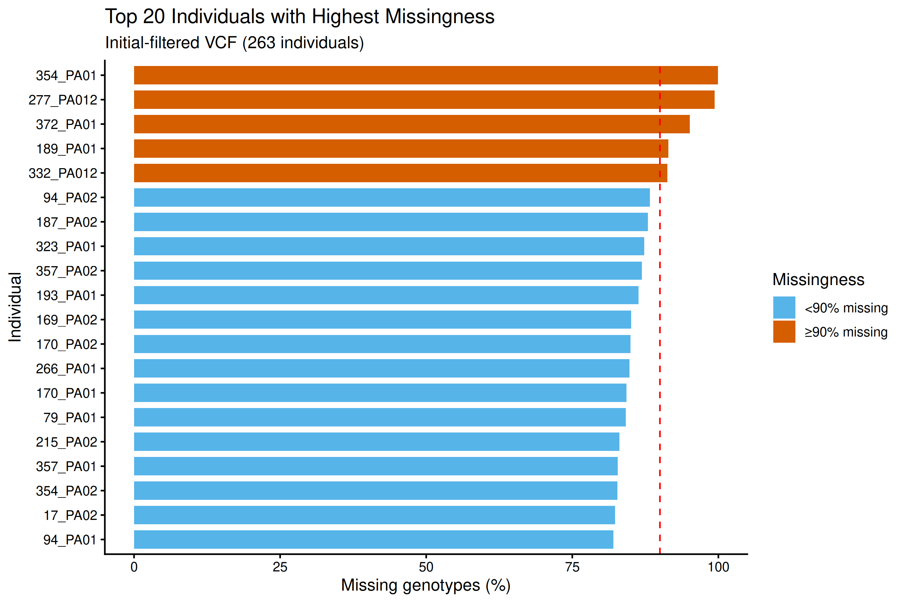

### 2. Assess Individual Missingness

**Important:** All 263 coral samples are being retained throughout SNP
filtering. Individual selection will occur after PCA, species
identification checks, and technical-replicate assessment. Diagnostic
analyses do not modify the VCF or remove samples.

### Table 2. Individual missingness distribution

Calculated using VCFtools `--missing-indv` on 8,933,146 SNPs across 263
individuals.

| **Individual missingness** | **Number of individuals** | **Percentage** |
|----------------------------|--------------------------:|---------------:|
| Less than 10%              |                         0 |           0.0% |
| 10–30%                     |                         0 |           0.0% |
| 30–50%                     |                         5 |           1.9% |
| 50–70%                     |                       118 |          44.9% |
| 70–90%                     |                       135 |          51.3% |
| 90% or greater             |                         5 |           1.9% |
| **Total**                  |                   **263** |       **100%** |

## Individual Missingness Filtering: Removal of Five Individuals

### Rationale

Following a discussion with my advisor, we decided to remove individuals with greater than 90% missing genotype data before continuing site-level SNP filtering. Individuals with extremely high missingness contribute little usable genotype information and may influence the distribution of site missingness across the dataset.

Individual missingness was previously calculated using VCFtools from `02_initial_vcftools.vcf.gz`, which contained **263 individuals and 8,933,146 SNPs**. The resulting `03_individual_missingness.imiss` file was examined to identify individuals with at least 90% missing genotypes.

### Individuals identified for removal

Five individuals exceeded the missingness threshold:

| Individual | Proportion missing (`F_MISS`) | Percent missing |
|---|---:|---:|
| 189_PA01 | 0.914451 | 91.45% |
| 277_PA012 | 0.993308 | 99.33% |
| 332_PA012 | 0.912504 | 91.25% |
| 354_PA01 | 0.999562 | 99.96% |
| 372_PA01 | 0.950981 | 95.10% |

