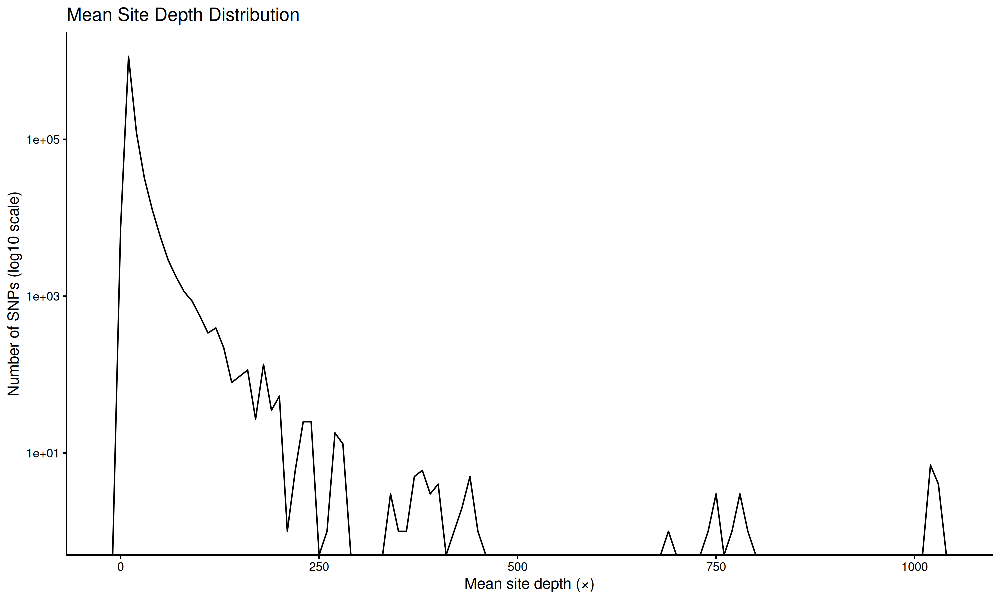

## Examination of Mean Site Depth

Mean sequencing depth was examined to identify low-coverage SNPs and unusually high-depth sites that could potentially represent repetitive genomic regions or mapping artifacts.

The mean site-depth distribution was calculated using VCFtools:

```bash
vcftools \
  --gzvcf 10_site70_mac2.vcf.gz \
  --site-mean-depth \
  --out 11_site_mean_depth_258ind_site70_mac2
```

**Output file:** `11_site_mean_depth_258ind_site70_mac2.ldepth.mean`

VCFtools confirmed that all 258 individuals and 1,332,396 SNPs were included. The output contained 1,332,397 lines, including the header.

### Visualizing mean site depth in R

```r
library(ggplot2)

depth <- read.table(
  "11_site_mean_depth_258ind_site70_mac2.ldepth.mean",
  header = TRUE
)

ggplot(depth, aes(MEAN_DEPTH)) +
  geom_freqpoly(binwidth = 5) +
  scale_y_continuous(trans = "log10") +
  labs(
    title = "Mean Site Depth Distribution",
    x = "Mean site depth (×)",
    y = "Number of SNPs (log10 scale)"
  ) +
  theme_classic()
```


The frequency polygon revealed a strong peak at relatively low mean sequencing depth and a long tail containing a small number of exceptionally high-depth SNPs.

### Mean site-depth summary

| Statistic | Mean site depth |
|---|---:|
| Minimum | 4.296× |
| First quartile | 8.567× |
| Median | 10.089× |
| Mean | 12.015× |
| Third quartile | 12.344× |
| Maximum | 1,026.350× |

The median mean site depth was approximately 10×, with the middle 50% of SNPs between approximately 8.6× and 12.3×.

### Evaluating maximum mean-depth thresholds

The number of SNPs exceeding several potential maximum mean-depth thresholds was calculated in R:

```r
thresholds <- c(50, 100, 200, 500)

data.frame(
  Max_Mean_Depth = thresholds,
  SNPs_Above = sapply(
    thresholds,
    function(x) sum(depth$MEAN_DEPTH > x)
  ),
  Percent_Above = round(
    sapply(
      thresholds,
      function(x) mean(depth$MEAN_DEPTH > x) * 100
    ),
    4
  )
)
```

| Maximum mean depth | SNPs exceeding threshold | Percentage exceeding threshold |
|---|---:|---:|
| 50× | 11,335 | 0.8507% |
| 100× | 1,898 | 0.1425% |
| 200× | 152 | 0.0114% |
| 500× | 21 | 0.0016% |

### Depth-filtering decision

**Proposed maximum mean depth: 500×.**

A maximum mean site depth of 500× was selected as a conservative upper threshold, consistent with the ezRAD analysis document. Only 21 SNPs (0.0016%) exceeded this value.

No additional minimum mean-depth threshold was selected at this stage because the primary depth distribution was relatively low and a minimum per-genotype depth of 3× had already been applied during initial filtering.

**Status:** Depth thresholds selected but not yet applied to the VCF.
