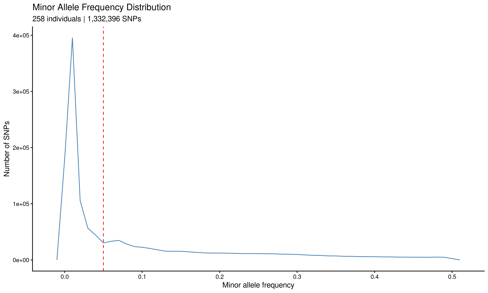

# 07. Evaluation of Global Minor Allele Frequency (MAF)

Minor allele frequency (MAF) was examined to determine an appropriate threshold for excluding rare variants while retaining genetic variation potentially relevant to individual-based seascape genomics analyses.

Because sampling was individual-based, with only 1–2 individuals per sampling site, population-specific MAF filtering was not considered appropriate. Instead, allele frequencies were calculated across all 258 retained individuals (global MAF).

## 07.1. Calculating allele frequencies

```bash
vcftools \
  --gzvcf 05_site70_mac2.vcf.gz \
  --freq2 \
  --out 07_maf_distribution
```

**Output file:** `07_maf_distribution.frq`

VCFtools reported allele-frequency statistics for all **1,332,396 SNPs across 258 individuals**.

## 07.2. Importing and calculating MAF in R

The VCFtools frequency file contained six data columns but only five header labels. To avoid an R import error caused by repeated scaffold names being interpreted as row names, the original header was skipped and column names were assigned manually.

```r
library(ggplot2)

maf <- read.table(
  "07_maf_distribution.frq",
  header = FALSE,
  skip = 1,
  col.names = c(
    "CHROM", "POS", "N_ALLELES",
    "N_CHR", "FREQ1", "FREQ2"
  )
)

maf$MAF <- pmin(maf$FREQ1, maf$FREQ2)

summary(maf$MAF)
```

The smaller of the two allele frequencies was used as the MAF for each biallelic SNP.

## 07.3. Visualizing the MAF distribution

```r
ggplot(maf, aes(x = MAF)) +
  geom_freqpoly(
    binwidth = 0.01,
    color = "steelblue"
  ) +
  geom_vline(
    xintercept = 0.05,
    linetype = "dashed",
    color = "red"
  ) +
  labs(
    title = "Minor Allele Frequency Distribution",
    subtitle = "258 individuals | 1,332,396 SNPs",
    x = "Minor allele frequency",
    y = "Number of SNPs"
  ) +
  theme_classic()
```



## 07.4. Comparison of candidate global MAF thresholds

Several MAF thresholds were evaluated without removing SNPs from the VCF:

```r
thresholds <- c(0.01, 0.02, 0.03, 0.05)

data.frame(
  Min_MAF = thresholds,
  SNPs_Retained = sapply(
    thresholds,
    function(x) sum(maf$MAF >= x, na.rm = TRUE)
  ),
  Percent_Retained = round(
    sapply(
      thresholds,
      function(x) mean(maf$MAF >= x, na.rm = TRUE) * 100
    ),
    2
  )
)
```

**Table. SNP retention under alternative global MAF thresholds.**

| Minimum global MAF | SNPs retained | SNPs removed | Retained (%) |
|---|---:|---:|---:|
| 0.01 | 879,199 | 453,197 | 65.99 |
| 0.02 | 687,360 | 645,036 | 51.59 |
| 0.03 | 624,857 | 707,539 | 46.90 |
| 0.05 | 536,457 | 795,939 | 40.26 |

All comparisons were based on the same input dataset of 1,332,396 SNPs.

A global MAF threshold of 0.05 would remove approximately 59.74% of SNPs, whereas a threshold of 0.01 would retain approximately 65.99%.

## 07.5. MAF-filtering decision

**Selected global MAF threshold: ≥0.01.**

The less restrictive threshold of 0.01 was selected to balance the exclusion of very rare variants with retention of potentially informative genetic variation.

Because the study examines genotype–environment relationships across individually sampled coral colonies, preserving variants that may be geographically restricted was considered important.

The selected threshold retains **879,199 SNPs**, approximately 342,742 more than a global MAF threshold of 0.05.

**Decision:** Apply global MAF ≥0.01 in stage 08.
