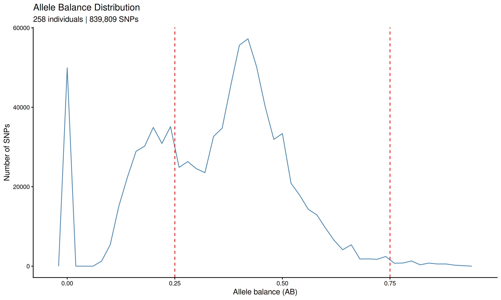

# 10. Allele-Balance Assessment and Filtering

Following the removal of alleles longer than one base, the dataset contained **839,809 SNPs across 258 individuals**.

Allele balance (AB) was evaluated to identify SNPs exhibiting unequal support from reads associated with reference and alternate alleles in heterozygous genotype calls. Substantial allele imbalance can be associated with sequencing errors, mapping artifacts, or other complications in variant calling.

Because *Pocillopora acuta* can exhibit clonality and potentially variable ploidy, AB filtering was evaluated separately from Hardy–Weinberg equilibrium filtering.

## 10.1. Extract allele-balance values

```bash
bcftools query \
  -f '%INFO/AB\n' \
  09_maf001_maxmeanDP500_LEN1.vcf.gz \
  > 10_allele_balance_values.txt
```

The distribution was examined in R:

```r
library(ggplot2)

ab <- read.table(
  "10_allele_balance_values.txt",
  header = FALSE,
  col.names = "AB",
  na.strings = "."
)

summary(ab$AB)

ggplot(ab, aes(x = AB)) +
  geom_histogram(
    binwidth = 0.02,
    fill = "steelblue",
    color = "white"
  ) +
  geom_vline(
    xintercept = c(0.25, 0.75),
    linetype = "dashed",
    color = "red"
  ) +
  labs(
    title = "Allele-Balance Distribution",
    subtitle = "258 individuals | 839,809 SNPs",
    x = "Allele balance (AB)",
    y = "Number of SNPs"
  ) +
  theme_classic()
```



## 10.2. Evaluate the allele-balance filter

The selected ezRAD filtering criterion was:

```text
(AB > 0.25 AND AB < 0.75) OR AB < 0.01
```

This retains SNPs with intermediate allele-balance values and includes a special exception for values below 0.01.

The exception was retained to reproduce the selected ezRAD filtering criterion, although its biological justification for *P. acuta* remains uncertain. In particular, AB values near zero should not automatically be interpreted as evidence of reliable allele balance.

| AB category | SNP count | Percentage | Filter outcome |
|---|---:|---:|---|
| AB < 0.01 | 49,923 | 5.94% | Retained |
| 0.01 ≤ AB ≤ 0.25 | 204,345 | 24.33% | Removed |
| 0.25 < AB < 0.75 | 578,479 | 68.88% | Retained |
| AB ≥ 0.75 | 7,062 | 0.84% | Removed |
| **Total** | **839,809** | **100%** | |

Overall, the AB filter retained **628,402 SNPs (74.83%)** and removed **211,407 SNPs (25.17%)**.

## 10.3. Apply allele-balance filtering

```bash
bcftools view \
  -i '(INFO/AB>0.25 && INFO/AB<0.75) || INFO/AB<0.01' \
  -Oz \
  -o 10_allele_balance_filtered.vcf.gz \
  09_maf001_maxmeanDP500_LEN1.vcf.gz

bcftools index -t 10_allele_balance_filtered.vcf.gz
```

The retained SNP count was confirmed as **628,402**, with **258 individuals** remaining.

## 10.4. Filtering decision - **REVISED - INFO BELOW**

Apply the selected ezRAD allele-balance criterion, retaining 628,402 SNPs for subsequent mapping-quality filtering.

**Final output:** `10_allele_balance_filtered.vcf.gz`

**Final SNP count:** **628,402**


#### CHANGE TO 0.3 and 0.75 as Maddie recommended

## Look at SNPs between 0.01 and 0.25 and then look at all the SNPs at the second peak and compare the individuals present 

## Make two different files of each vcf filtered for 05AB and 0.3AB and then look at missingness in each one 

## 10.3. Apply revised allele-balance filtering

Following consultation with Maddie, the lower allele-balance threshold was increased from **0.25 to 0.30**, based on a clear break observed in the allele-balance distribution.

The upper threshold was retained at **0.75**. The original exception for `AB < 0.01` was also retained.

The revised filtering criterion was:

```text
(AB > 0.30 AND AB < 0.75) OR AB < 0.01
```

The filter was applied using:

```bash
bcftools view \
  -i '(INFO/AB>0.30 && INFO/AB<0.75) || INFO/AB<0.01' \
  -Oz \
  -o 10_allele_balance_filtered_AB030.vcf.gz \
  09_maf001_maxmeanDP500_LEN1.vcf.gz

bcftools index -t 10_allele_balance_filtered_AB030.vcf.gz
```

**Input VCF:** `09_maf001_maxmeanDP500_LEN1.vcf.gz`

**Input SNP count:** 839,809

**Individuals:** 258

**Revised SNP count:** Pending confirmation.

## 10.4. Filtering decision -

The revised allele-balance filtering threshold was selected following examination of the allele-balance distribution and discussion with Maddie.

The lower threshold was increased to **0.30** to exclude additional SNPs exhibiting allele imbalance, while retaining the original upper threshold of **0.75**.

The `AB < 0.01` exception remains part of the filtering criterion and should be evaluated separately if its biological justification is reconsidered.

**Final output:** `10_allele_balance_filtered_AB030.vcf.gz`

**Final SNP count:** Pending confirmation.

**Final individual count:** 258

**Next step:** Reapply mapping-quality filtering to the revised allele-balance-filtered VCF.

#Look at which individuals are called at those sites vs which ones are missing 

**Final individual count:** **258**

**Next step:** Assess and filter mapping quality.

## REVISED 

# 09. Single-Base Allele Filtering

## Objective

This filtering step removed VCF records containing reference or alternate alleles longer than one nucleotide.

Although the original pipeline selected SNPs, additional records with multibase alleles remained.

To ensure that downstream analyses used only single-nucleotide substitutions, the lengths of the REF and ALT alleles were evaluated directly.

## Filtering criterion

Retain records satisfying:

```text
strlen(REF) == 1 AND strlen(ALT) == 1
```

## Neutral dataset

**Input:** `Neutral_MAF005/Neutral_08_maf005_maxmeanDP500.vcf.gz`

```bash
bcftools view \
  -e 'strlen(REF)!=1 || strlen(ALT)!=1' \
  -Oz \
  -o Neutral_MAF005/Neutral_09_maf005_maxmeanDP500_LEN1.vcf.gz \
  Neutral_MAF005/Neutral_08_maf005_maxmeanDP500.vcf.gz

bcftools index -t \
  Neutral_MAF005/Neutral_09_maf005_maxmeanDP500_LEN1.vcf.gz
```

## Adaptive dataset

**Input:** `Adaptive_MAF001/Adaptive_08_maf001_maxmeanDP500.vcf.gz`

```bash
bcftools view \
  -e 'strlen(REF)!=1 || strlen(ALT)!=1' \
  -Oz \
  -o Adaptive_MAF001/Adaptive_09_maf001_maxmeanDP500_LEN1.vcf.gz \
  Adaptive_MAF001/Adaptive_08_maf001_maxmeanDP500.vcf.gz

bcftools index -t \
  Adaptive_MAF001/Adaptive_09_maf001_maxmeanDP500_LEN1.vcf.gz
```

## Filtering results

| Dataset | Input SNPs | SNPs removed | SNPs retained | Percentage removed |
|---|---:|---:|---:|---:|
| Neutral | 536,448 | **35,149** | **501,299** | 6.55% |
| Adaptive | 879,186 | **39,377** | **839,809** | 4.48% |

Both datasets retained **258 individuals**.

## Interpretation

The filter excluded records with multibase alleles, producing datasets containing only single-base REF and ALT alleles.

This standardizes variant representation for downstream population genomic analyses.

## Final outputs

**Neutral:** `Neutral_MAF005/Neutral_09_maf005_maxmeanDP500_LEN1.vcf.gz`

**Adaptive:** `Adaptive_MAF001/Adaptive_09_maf001_maxmeanDP500_LEN1.vcf.gz`

**Next step:** Revised allele-balance filtering.

## REVISED 

# 10. Allele-Balance Assessment and Revised Filtering

## Objective

Allele balance (AB) was examined to identify SNPs with potentially unreliable representation of reference and alternate alleles in sequencing reads.

Strong allele imbalance may reflect sequencing artifacts, mapping problems, or biological processes that complicate genotype calling.

## Original allele-balance assessment

The original allele-balance distribution was generated from the Adaptive dataset before the revised filtering decision.


The original criterion was:

```text
(AB > 0.25 AND AB < 0.75) OR AB < 0.01
```

This retained **628,402 SNPs** from an input of 839,809 SNPs.

## Revised filtering decision

Following discussion with advisor Maddie, the lower allele-balance threshold was increased from **0.25 to 0.30**.

A clear break in the observed AB distribution supported the revised threshold.

The upper threshold remained **0.75**.

The original exception for `AB < 0.01` was retained to preserve consistency with the selected ezRAD filtering approach.

The revised criterion was:

```text
(AB > 0.30 AND AB < 0.75) OR AB < 0.01
```

The `AB < 0.01` exception should be interpreted cautiously because its biological justification for *Pocillopora acuta* remains uncertain.

## Neutral dataset

**Input:** `Neutral_MAF005/Neutral_09_maf005_maxmeanDP500_LEN1.vcf.gz`

```bash
bcftools view \
  -i '(INFO/AB>0.30 && INFO/AB<0.75) || INFO/AB<0.01' \
  -Oz \
  -o Neutral_MAF005/Neutral_10_allele_balance_AB030.vcf.gz \
  Neutral_MAF005/Neutral_09_maf005_maxmeanDP500_LEN1.vcf.gz

bcftools index -t \
  Neutral_MAF005/Neutral_10_allele_balance_AB030.vcf.gz
```

## Adaptive dataset

**Input:** `Adaptive_MAF001/Adaptive_09_maf001_maxmeanDP500_LEN1.vcf.gz`

```bash
bcftools view \
  -i '(INFO/AB>0.30 && INFO/AB<0.75) || INFO/AB<0.01' \
  -Oz \
  -o Adaptive_MAF001/Adaptive_10_allele_balance_AB030.vcf.gz \
  Adaptive_MAF001/Adaptive_09_maf001_maxmeanDP500_LEN1.vcf.gz

bcftools index -t \
  Adaptive_MAF001/Adaptive_10_allele_balance_AB030.vcf.gz
```

## Revised filtering results

| Dataset | Input SNPs | SNPs removed | SNPs retained | Percentage removed |
|---|---:|---:|---:|---:|
| Neutral | 501,299 | **118,176** | **383,123** | 23.57% |
| Adaptive | 839,809 | **275,690** | **564,119** | 32.83% |

Both datasets retained **258 individuals**.

## Comparison with the original allele-balance filter

| Adaptive filtering criterion | SNPs retained |
|---|---:|
| Original: AB >0.25 and <0.75, or AB <0.01 | 628,402 |
| Revised: AB >0.30 and <0.75, or AB <0.01 | **564,119** |
| Additional SNPs removed by revision | **64,283** |

## Interpretation

Increasing the lower AB threshold removed additional SNPs with relatively low allele-balance values.

The revised criterion was applied consistently to both datasets.

The original results were preserved as part of the filtering decision history.

## Final outputs

**Neutral:** `Neutral_MAF005/Neutral_10_allele_balance_AB030.vcf.gz`

**Adaptive:** `Adaptive_MAF001/Adaptive_10_allele_balance_AB030.vcf.gz`

**Next step:** Mapping-quality filtering.
