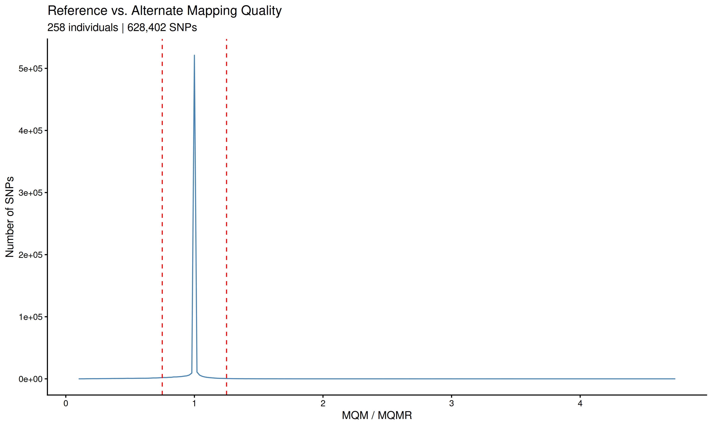

# 11. Mapping-Quality Assessment and Filtering

Mapping-quality filtering was performed **after allele-balance filtering** using `10_allele_balance_filtered.vcf.gz`, containing **628,402 SNPs across 258 individuals**.

The FreeBayes annotations `MQM` and `MQMR` summarize the mapping quality of reads supporting alternate and reference alleles, respectively. SNPs with low mapping quality or substantial differences between these values may be more susceptible to incorrect read placement and variant calls.

## 11.1. Extract MQM and MQMR values

```bash
bcftools query \
  -f '%CHROM\t%POS\t%INFO/MQM\t%INFO/MQMR\n' \
  10_allele_balance_filtered.vcf.gz \
  > 11_mapping_quality_values.tsv
```

Mapping-quality statistics were examined in R:

```r
mq <- read.table(
  "11_mapping_quality_values.tsv",
  header = FALSE,
  col.names = c("CHROM", "POS", "MQM", "MQMR"),
  na.strings = "."
)

nrow(mq)

summary(mq$MQM)
summary(mq$MQMR)

data.frame(
  Metric = c("MQM", "MQMR"),
  Missing = c(
    sum(is.na(mq$MQM)),
    sum(is.na(mq$MQMR))
  ),
  Zero = c(
    sum(mq$MQM == 0, na.rm = TRUE),
    sum(mq$MQMR == 0, na.rm = TRUE)
  )
)

mq$MQ_ratio <- mq$MQM / mq$MQMR

summary(mq$MQ_ratio)
```

The ratio `MQM/MQMR` was used to evaluate whether reads supporting alternate and reference alleles had comparable mapping qualities.

## 11.2. Visualize the mapping-quality ratio

```r
library(ggplot2)

ggplot(mq, aes(x = MQ_ratio)) +
  geom_freqpoly(
    binwidth = 0.02,
    color = "steelblue"
  ) +
  geom_vline(
    xintercept = c(0.75, 1.25),
    linetype = "dashed",
    color = "red"
  ) +
  labs(
    title = "Reference vs. Alternate Mapping Quality",
    subtitle = "258 individuals | 628,402 SNPs",
    x = "MQM / MQMR",
    y = "Number of SNPs"
  ) +
  theme_classic()

ggsave(
  "11_mapping_quality_ratio.png",
  width = 10,
  height = 6,
  dpi = 300
)
```



The dashed red lines indicate the acceptable mapping-quality ratio range of **0.75–1.25**. Ratios near 1 indicate similar mapping qualities for reads supporting reference and alternate alleles.

This figure illustrates the ratio criterion; the full filter additionally requires both MQM and MQMR to exceed 30.

## 11.3. Apply the mapping-quality filter

The following criteria were selected:

- `MQM > 30`
- `MQMR > 30`
- `MQM/MQMR > 0.75`
- `MQM/MQMR < 1.25`

```bash
bcftools view \
  -i 'INFO/MQM>30 && INFO/MQMR>30 && INFO/MQM/INFO/MQMR>0.75 && INFO/MQM/INFO/MQMR<1.25' \
  -Oz \
  -o 11_mapping_quality_filtered.vcf.gz \
  10_allele_balance_filtered.vcf.gz

bcftools index -t 11_mapping_quality_filtered.vcf.gz
```

## 11.4. Filtering results

| Metric | SNP count |
|---|---:|
| SNPs before mapping-quality filtering | 628,402 |
| SNPs removed | 32,596 |
| SNPs retained | **595,806** |
| Percentage removed | 5.19% |
| Percentage retained | 94.81% |
| Individuals retained | **258** |

## 11.5. Validate the filtered VCF

```bash
bgzip -t 11_mapping_quality_filtered.vcf.gz

bcftools index -n 11_mapping_quality_filtered.vcf.gz

bcftools query -l 11_mapping_quality_filtered.vcf.gz | wc -l
```

The validation returned **595,806 SNPs and 258 individuals**.

All integrity checks passed, confirming that the compressed VCF was readable, its index was consistent, and all 258 individuals were retained.

A recurring VCF-header warning indicated that the `GQ` field should be declared as `Type=Integer`. This warning originated from the input VCF header and did not prevent successful filtering or validation.

## 11.6. Filtering decision

Apply the MQM/MQMR filter after allele-balance filtering.

**Final output:** `11_mapping_quality_filtered.vcf.gz`

### REVISED

# 11. Mapping-Quality Assessment and Filtering

## Objective

Mapping-quality filtering was used to remove SNPs with low mapping quality or substantial differences between reads supporting reference and alternate alleles.

FreeBayes provides two relevant annotations:

- `MQM`: Mean mapping quality of reads supporting the alternate allele.
- `MQMR`: Mean mapping quality of reads supporting the reference allele.

The ratio `MQM/MQMR` was examined to identify SNPs with imbalanced mapping qualities.

## Filtering criteria

The same criteria were applied to both datasets:

```text
MQM > 30
MQMR > 30
MQM/MQMR > 0.75
MQM/MQMR < 1.25
```

## Neutral dataset

**Input:** `Neutral_MAF005/Neutral_10_allele_balance_AB030.vcf.gz`

```bash
bcftools view \
  -i 'INFO/MQM>30 && INFO/MQMR>30 && INFO/MQM/INFO/MQMR>0.75 && INFO/MQM/INFO/MQMR<1.25' \
  -Oz \
  -o Neutral_MAF005/Neutral_11_mapping_quality_filtered.vcf.gz \
  Neutral_MAF005/Neutral_10_allele_balance_AB030.vcf.gz

bcftools index -t \
  Neutral_MAF005/Neutral_11_mapping_quality_filtered.vcf.gz
```

## Adaptive dataset

**Input:** `Adaptive_MAF001/Adaptive_10_allele_balance_AB030.vcf.gz`

```bash
bcftools view \
  -i 'INFO/MQM>30 && INFO/MQMR>30 && INFO/MQM/INFO/MQMR>0.75 && INFO/MQM/INFO/MQMR<1.25' \
  -Oz \
  -o Adaptive_MAF001/Adaptive_11_mapping_quality_filtered.vcf.gz \
  Adaptive_MAF001/Adaptive_10_allele_balance_AB030.vcf.gz

bcftools index -t \
  Adaptive_MAF001/Adaptive_11_mapping_quality_filtered.vcf.gz
```

## Filtering results

| Dataset | Input SNPs | SNPs removed | SNPs retained | Percentage removed |
|---|---:|---:|---:|---:|
| Neutral | 383,123 | **14,600** | **368,523** | 3.81% |
| Adaptive | 564,119 | **22,595** | **541,524** | 4.01% |

Both datasets retained **258 individuals**.

## Comparison with the original pipeline

Before the AB threshold was revised, the original Adaptive dataset retained **595,806 SNPs** following mapping-quality filtering.

After increasing the lower AB threshold to 0.30, the revised Adaptive dataset retained **541,524 SNPs**.

This represents **54,282 fewer SNPs** in the revised dataset after Stage 11.

## Validation

The final SNP counts were confirmed using:

```bash
bcftools index -n \
  Neutral_MAF005/Neutral_11_mapping_quality_filtered.vcf.gz

bcftools index -n \
  Adaptive_MAF001/Adaptive_11_mapping_quality_filtered.vcf.gz
```

Individual counts were confirmed using:

```bash
bcftools query -l \
  Neutral_MAF005/Neutral_11_mapping_quality_filtered.vcf.gz | wc -l

bcftools query -l \
  Adaptive_MAF001/Adaptive_11_mapping_quality_filtered.vcf.gz | wc -l
```

A recurring VCF header warning indicated that `GQ` should be declared as `Type=Integer`. This warning did not prevent indexing or retrieval of SNP and individual counts.

## Final outputs

**Neutral:** `Neutral_MAF005/Neutral_11_mapping_quality_filtered.vcf.gz`

- **368,523 SNPs**
- **258 individuals**

**Adaptive:** `Adaptive_MAF001/Adaptive_11_mapping_quality_filtered.vcf.gz`

- **541,524 SNPs**
- **258 individuals**

**Next step:** Heterozygosity assessment for both datasets.

**Final SNP count:** **595,806**

**Final individual count:** **258**

**Next step:** Assess heterozygosity in stage 12.
