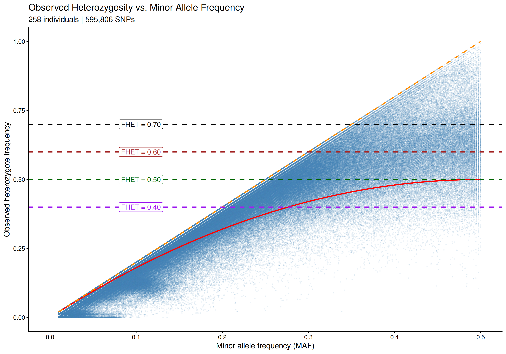

# 12. Heterozygosity Assessment and Hardy–Weinberg Equilibrium (HWE) Decision

Following mapping-quality filtering, the dataset contained **595,806 SNPs across 258 individuals**.

Observed heterozygosity was evaluated in relation to minor allele frequency (MAF) to investigate loci with unusually high heterozygote frequencies.

Because *Pocillopora acuta* exhibits both sexual and asexual reproduction and the study system may include triploid individuals, heterozygosity patterns require careful interpretation.

## 12.1. Calculate allele frequencies and heterozygosity statistics

```bash
vcftools \
  --gzvcf 11_mapping_quality_filtered.vcf.gz \
  --freq \
  --out 12_heterozygosity_maf

vcftools \
  --gzvcf 11_mapping_quality_filtered.vcf.gz \
  --hardy \
  --out 12_heterozygosity_hwe
```

These commands generated allele-frequency and observed genotype-count summaries for the 595,806 retained SNPs.

**Output files:**

- `12_heterozygosity_maf.frq`
- `12_heterozygosity_hwe.hwe`

## 12.2. Calculate observed heterozygote frequency in R

```r
library(ggplot2)

freq <- read.table(
  "12_heterozygosity_maf.frq",
  header = FALSE,
  skip = 1,
  col.names = c(
    "CHROM", "POS", "N_ALLELES",
    "N_CHR", "FREQ1", "FREQ2"
  )
)

freq$FREQ1 <- as.numeric(sub(".*:", "", freq$FREQ1))
freq$FREQ2 <- as.numeric(sub(".*:", "", freq$FREQ2))

freq$MAF <- pmin(freq$FREQ1, freq$FREQ2)

het <- read.table(
  "12_heterozygosity_hwe.hwe",
  header = TRUE,
  check.names = FALSE
)

obs <- strsplit(
  het[["OBS(HOM1/HET/HOM2)"]],
  "/"
)

obs <- do.call(rbind, obs)
storage.mode(obs) <- "numeric"

het$N_HOM1 <- obs[, 1]
het$N_HET <- obs[, 2]
het$N_HOM2 <- obs[, 3]

het$N_CALLED <- (
  het$N_HOM1 +
  het$N_HET +
  het$N_HOM2
)

het$FHET_OBS <- het$N_HET / het$N_CALLED

het_maf <- merge(
  freq[, c("CHROM", "POS", "MAF")],
  het[, c("CHR", "POS", "FHET_OBS")],
  by.x = c("CHROM", "POS"),
  by.y = c("CHR", "POS")
)
```

The observed heterozygote frequency was calculated as the proportion of called genotypes classified as heterozygous at each SNP.

## 12.3. Visualize heterozygosity versus MAF

```r
ggplot(het_maf, aes(x = MAF, y = FHET_OBS)) +
  geom_point(
    alpha = 0.08,
    size = 0.25,
    color = "steelblue"
  ) +
  stat_function(
    fun = function(x) 2 * x * (1 - x),
    color = "red",
    linewidth = 0.8
  ) +
  stat_function(
    fun = function(x) 2 * x,
    color = "darkorange",
    linetype = "dashed",
    linewidth = 0.8
  ) +
  geom_hline(
    yintercept = c(0.4, 0.5, 0.6, 0.7),
    color = c("purple", "darkgreen", "brown", "black"),
    linetype = "dashed",
    linewidth = 0.8
  ) +
  annotate(
    "label",
    x = 0.08,
    y = c(0.4, 0.5, 0.6, 0.7),
    label = c(
      "FHET = 0.40",
      "FHET = 0.50",
      "FHET = 0.60",
      "FHET = 0.70"
    ),
    color = c("purple", "darkgreen", "brown", "black"),
    fill = "white",
    size = 3.5,
    hjust = 0
  ) +
  coord_cartesian(
    xlim = c(0, 0.5),
    ylim = c(0, 1)
  ) +
  labs(
    title = "Observed Heterozygosity vs. Minor Allele Frequency",
    subtitle = "258 individuals | 595,806 SNPs",
    x = "Minor allele frequency (MAF)",
    y = "Observed heterozygote frequency"
  ) +
  theme_classic()

ggsave(
  "12_maf_vs_heterozygosity_cutoff_comparison.png",
  width = 10,
  height = 7,
  dpi = 300
)
```



The red curve represents expected heterozygosity under diploid Hardy–Weinberg equilibrium, calculated as `2p(1-p)`.

The orange dashed line represents the theoretical maximum observed heterozygote frequency of `2p` under a diploid biallelic model, where `p` is the minor allele frequency.

Horizontal lines show candidate observed heterozygote-frequency thresholds of 0.40, 0.50, 0.60, and 0.70.

## 12.4. Hardy–Weinberg equilibrium filtering decision

**HWE significance filtering will not be applied.**

*Pocillopora acuta* exhibits both sexual and asexual reproduction, and the study system may include triploid individuals. These biological characteristics can violate assumptions underlying conventional diploid HWE tests.

Furthermore, departures from HWE may reflect population structure, reproductive biology, or selection and are not necessarily indicators of poor SNP quality. Removing such loci could eliminate variation relevant to seascape genomics.

Therefore, HWE deviation will not be used as a SNP exclusion criterion.

## 12.5. Heterozygosity filtering status

Observed heterozygosity is being evaluated as a separate quality-control diagnostic.

No final observed heterozygote-frequency cutoff has yet been selected or applied.

**Current input VCF:** `11_mapping_quality_filtered.vcf.gz`

**Current SNP count:** **595,806**

**Current individual count:** **258**

**Status:** Heterozygosity assessment completed; filtering decision pending further evaluation.

## Maddie recommends using 0.75 as that is where the curve asymptotes. 
