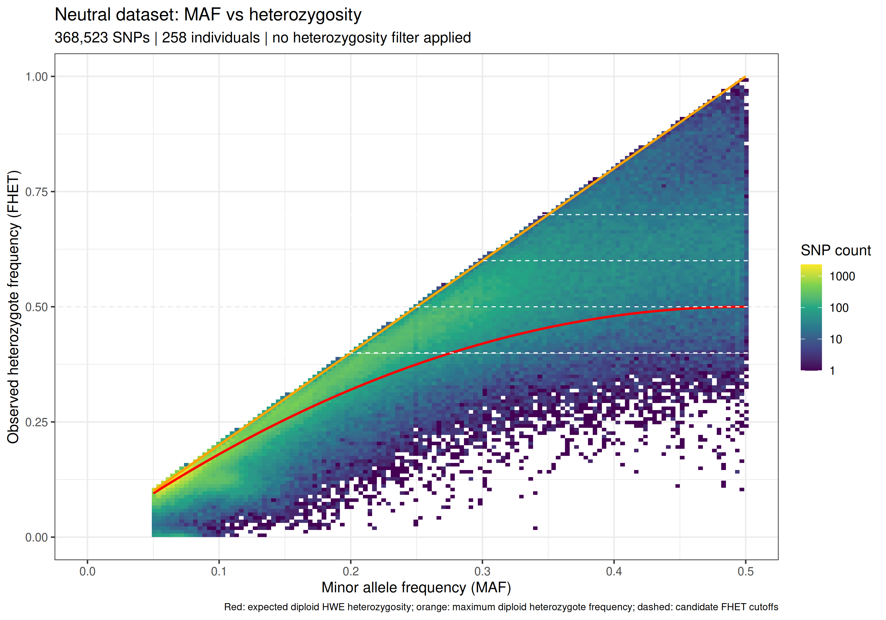
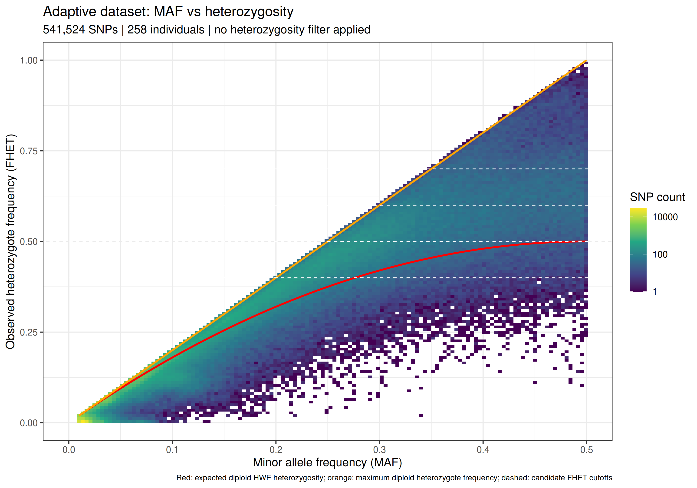

# 12. Heterozygosity Assessment and Hardy–Weinberg Equilibrium (HWE) Decision

Following mapping-quality filtering, the dataset contained **595,806 SNPs across 258 individuals**.

Observed heterozygosity was evaluated in relation to minor allele frequency (MAF) to investigate loci with unusually high heterozygote frequencies.

Because *Pocillopora acuta* exhibits both sexual and asexual reproduction and the study system may include triploid individuals, heterozygosity patterns require careful interpretation.

## 12.1. Calculate allele frequencies and heterozygosity statistics

```bash
vcftools \
  --gzvcf 11_mapping_quality_filtered.vcf.gz \
  --freq \
  --out 12_heterozygosity_maf

vcftools \
  --gzvcf 11_mapping_quality_filtered.vcf.gz \
  --hardy \
  --out 12_heterozygosity_hwe
```

These commands generated allele-frequency and observed genotype-count summaries for the 595,806 retained SNPs.

**Output files:**

- `12_heterozygosity_maf.frq`
- `12_heterozygosity_hwe.hwe`

## 12.2. Calculate observed heterozygote frequency in R

```r
library(ggplot2)

freq <- read.table(
  "12_heterozygosity_maf.frq",
  header = FALSE,
  skip = 1,
  col.names = c(
    "CHROM", "POS", "N_ALLELES",
    "N_CHR", "FREQ1", "FREQ2"
  )
)

freq$FREQ1 <- as.numeric(sub(".*:", "", freq$FREQ1))
freq$FREQ2 <- as.numeric(sub(".*:", "", freq$FREQ2))

freq$MAF <- pmin(freq$FREQ1, freq$FREQ2)

het <- read.table(
  "12_heterozygosity_hwe.hwe",
  header = TRUE,
  check.names = FALSE
)

obs <- strsplit(
  het[["OBS(HOM1/HET/HOM2)"]],
  "/"
)

obs <- do.call(rbind, obs)
storage.mode(obs) <- "numeric"

het$N_HOM1 <- obs[, 1]
het$N_HET <- obs[, 2]
het$N_HOM2 <- obs[, 3]

het$N_CALLED <- (
  het$N_HOM1 +
  het$N_HET +
  het$N_HOM2
)

het$FHET_OBS <- het$N_HET / het$N_CALLED

het_maf <- merge(
  freq[, c("CHROM", "POS", "MAF")],
  het[, c("CHR", "POS", "FHET_OBS")],
  by.x = c("CHROM", "POS"),
  by.y = c("CHR", "POS")
)
```

The observed heterozygote frequency was calculated as the proportion of called genotypes classified as heterozygous at each SNP.

## 12.3. Visualize heterozygosity versus MAF

```r
ggplot(het_maf, aes(x = MAF, y = FHET_OBS)) +
  geom_point(
    alpha = 0.08,
    size = 0.25,
    color = "steelblue"
  ) +
  stat_function(
    fun = function(x) 2 * x * (1 - x),
    color = "red",
    linewidth = 0.8
  ) +
  stat_function(
    fun = function(x) 2 * x,
    color = "darkorange",
    linetype = "dashed",
    linewidth = 0.8
  ) +
  geom_hline(
    yintercept = c(0.4, 0.5, 0.6, 0.7),
    color = c("purple", "darkgreen", "brown", "black"),
    linetype = "dashed",
    linewidth = 0.8
  ) +
  annotate(
    "label",
    x = 0.08,
    y = c(0.4, 0.5, 0.6, 0.7),
    label = c(
      "FHET = 0.40",
      "FHET = 0.50",
      "FHET = 0.60",
      "FHET = 0.70"
    ),
    color = c("purple", "darkgreen", "brown", "black"),
    fill = "white",
    size = 3.5,
    hjust = 0
  ) +
  coord_cartesian(
    xlim = c(0, 0.5),
    ylim = c(0, 1)
  ) +
  labs(
    title = "Observed Heterozygosity vs. Minor Allele Frequency",
    subtitle = "258 individuals | 595,806 SNPs",
    x = "Minor allele frequency (MAF)",
    y = "Observed heterozygote frequency"
  ) +
  theme_classic()

ggsave(
  "12_maf_vs_heterozygosity_cutoff_comparison.png",
  width = 10,
  height = 7,
  dpi = 300
)
```


The red curve represents expected heterozygosity under diploid Hardy–Weinberg equilibrium, calculated as `2p(1-p)`.

The orange dashed line represents the theoretical maximum observed heterozygote frequency of `2p` under a diploid biallelic model, where `p` is the minor allele frequency.

Horizontal lines show candidate observed heterozygote-frequency thresholds of 0.40, 0.50, 0.60, and 0.70.

## 12.4. Hardy–Weinberg equilibrium filtering decision

**HWE significance filtering will not be applied.**

*Pocillopora acuta* exhibits both sexual and asexual reproduction, and the study system may include triploid individuals. These biological characteristics can violate assumptions underlying conventional diploid HWE tests.

Furthermore, departures from HWE may reflect population structure, reproductive biology, or selection and are not necessarily indicators of poor SNP quality. Removing such loci could eliminate variation relevant to seascape genomics.

Therefore, HWE deviation will not be used as a SNP exclusion criterion.

## 12.5. Heterozygosity filtering status

Observed heterozygosity is being evaluated as a separate quality-control diagnostic.

No final observed heterozygote-frequency cutoff has yet been selected or applied.

**Current input VCF:** `11_mapping_quality_filtered.vcf.gz`

**Current SNP count:** **595,806**

**Current individual count:** **258**

**Status:** Heterozygosity assessment completed; filtering decision pending further evaluation.

## Maddie recommends using 0.75 as that is where the curve asymptotes. 

#### REVISED

# 12. Heterozygosity Assessment and Filtering

Excessively high heterozygosity may indicate collapsed paralogous regions, repetitive sequences, or genotyping artifacts. However, elevated heterozygosity may also reflect genuine biological variation in *Pocillopora acuta*, including clonality and potential ploidy variation.

Separate heterozygosity thresholds were selected for the Neutral and Adaptive datasets.

## Input datasets

| Dataset | Global MAF threshold | Input SNPs | Individuals |
|---|---:|---:|---:|
| Neutral | ≥0.05 | 368,523 | 258 |
| Adaptive | ≥0.01 | 541,524 | 258 |

## Calculate allele frequencies and heterozygosity statistics

### Neutral dataset

```bash
vcftools \
  --gzvcf Neutral_MAF005/Neutral_11_mapping_quality_filtered.vcf.gz \
  --freq \
  --out Neutral_MAF005/Neutral_12_heterozygosity_maf

vcftools \
  --gzvcf Neutral_MAF005/Neutral_11_mapping_quality_filtered.vcf.gz \
  --hardy \
  --out Neutral_MAF005/Neutral_12_heterozygosity_hwe
```

### Adaptive dataset

```bash
vcftools \
  --gzvcf Adaptive_MAF001/Adaptive_11_mapping_quality_filtered.vcf.gz \
  --freq \
  --out Adaptive_MAF001/Adaptive_12_heterozygosity_maf

vcftools \
  --gzvcf Adaptive_MAF001/Adaptive_11_mapping_quality_filtered.vcf.gz \
  --hardy \
  --out Adaptive_MAF001/Adaptive_12_heterozygosity_hwe
```

Both analyses completed successfully and included all input SNPs and individuals.

| Dataset | Frequency records | HWE records | HWE runtime |
|---|---:|---:|---:|
| Neutral | 368,523 | 368,523 | 27 seconds |
| Adaptive | 541,524 | 541,524 | 35 seconds |

## Calculate observed heterozygote frequency

Observed heterozygote frequency was calculated from the observed genotype counts reported in the VCFtools HWE output.

```
FHET = HET / (HOM1 + HET + HOM2)
```

Missing genotypes were excluded from the denominator.

Minor allele frequency was calculated as the smaller of the two allele frequencies reported for each biallelic locus.
```

The script produced per-SNP diagnostic tables and separate MAF-versus-heterozygosity plots for both datasets.

## R troubleshooting and reproducibility

The VCFtools `.frq` files contained five header fields but six data columns for biallelic loci.

To accommodate this format, the header was skipped and six column names were assigned explicitly.

```r
freq <- read.table(
  freq_file,
  header = FALSE,
  skip = 1,
  sep = "",
  stringsAsFactors = FALSE,
  col.names = c(
    "CHROM", "POS", "N_ALLELES",
    "N_CHR", "ALLELE1", "ALLELE2"
  )
)

allele1 <- as.numeric(sub(".*:", "", freq$ALLELE1))
allele2 <- as.numeric(sub(".*:", "", freq$ALLELE2))

maf <- pmin(allele1, allele2)

stopifnot(!anyNA(maf))
```

This modification resolved the duplicate row-name and allele-column identification errors encountered during the initial R analysis.

## Heterozygosity assessment figures

### Neutral dataset



### Adaptive dataset



The plots show the distribution of observed heterozygote frequencies relative to global MAF.

The red curve represents expected diploid heterozygosity under Hardy–Weinberg equilibrium:

`H_E = 2p(1-p)`

The orange curve represents the maximum theoretical diploid heterozygote frequency:

`H_max = 2p`

Dashed horizontal lines represent the initially evaluated FHET thresholds of 0.40, 0.50, 0.60, and 0.70.

The final Adaptive threshold of 0.75 was evaluated separately after the initial plots were generated.

## Original heterozygosity assessment

An earlier heterozygosity assessment was conducted on the original MAF ≥0.01 dataset containing 595,806 SNPs, before the allele-balance threshold was revised from 0.25 to 0.30.


This assessment was superseded by the separate Neutral and Adaptive analyses.

## Hardy–Weinberg equilibrium filtering decision

No filtering based on HWE significance was applied.

Population structure, clonality, and potential ploidy variation in *Pocillopora acuta* may violate the assumptions underlying conventional diploid HWE tests.

HWE output was therefore used to obtain observed genotype counts and assess heterozygosity rather than exclude loci based on statistical significance.

## Final heterozygosity thresholds

Separate maximum observed heterozygote frequencies were selected for the two datasets.

- Neutral: FHET ≤0.70
- Adaptive: FHET ≤0.75

The Neutral dataset received a more stringent heterozygosity filter, whereas the Adaptive dataset retained a broader range of observed genetic variation.

These thresholds represent analytical filtering decisions rather than experimentally validated boundaries between genuine variation and genotyping artifacts.

## Generate retained SNP position lists

The per-SNP diagnostic CSV files were used to generate chromosome and position lists identifying SNPs that satisfied the selected thresholds.

The following R commands were executed through the Linux terminal.

```bash
Rscript - <<'RSCRIPT'
neutral <- read.csv(
  "Neutral_MAF005/Neutral_12_heterozygosity_per_snp.csv"
)

adaptive <- read.csv(
  "Adaptive_MAF001/Adaptive_12_heterozygosity_per_snp.csv"
)

stopifnot(
  nrow(neutral) == 368523,
  nrow(adaptive) == 541524,
  !anyNA(neutral$FHET),
  !anyNA(adaptive$FHET)
)

neutral_kept <- neutral[
  neutral$FHET <= 0.70,
  c("CHR", "POS")
]

write.table(
  neutral_kept,
  "Neutral_MAF005/Neutral_12_keep_FHET070.txt",
  quote = FALSE,
  row.names = FALSE,
  col.names = FALSE,
  sep = "\t"
)

adaptive_kept <- adaptive[
  adaptive$FHET <= 0.75,
  c("CHR", "POS")
]

write.table(
  adaptive_kept,
  "Adaptive_MAF001/Adaptive_12_keep_FHET075.txt",
  quote = FALSE,
  row.names = FALSE,
  col.names = FALSE,
  sep = "\t"
)
RSCRIPT
```

## Apply heterozygosity filtering

VCFtools `--positions` was used to retain only SNPs passing the selected heterozygosity thresholds.

### Neutral dataset — FHET ≤0.70

```bash
vcftools \
  --gzvcf Neutral_MAF005/Neutral_11_mapping_quality_filtered.vcf.gz \
  --positions Neutral_MAF005/Neutral_12_keep_FHET070.txt \
  --recode \
  --recode-INFO-all \
  --stdout \
  2> Neutral_MAF005/Neutral_12_FHET070.log \
| bgzip -c > Neutral_MAF005/Neutral_12_FHET070_filtered.vcf.gz

bcftools index -t \
  Neutral_MAF005/Neutral_12_FHET070_filtered.vcf.gz
```

### Adaptive dataset — FHET ≤0.75

```bash
vcftools \
  --gzvcf Adaptive_MAF001/Adaptive_11_mapping_quality_filtered.vcf.gz \
  --positions Adaptive_MAF001/Adaptive_12_keep_FHET075.txt \
  --recode \
  --recode-INFO-all \
  --stdout \
  2> Adaptive_MAF001/Adaptive_12_FHET075.log \
| bgzip -c > Adaptive_MAF001/Adaptive_12_FHET075_filtered.vcf.gz

bcftools index -t \
  Adaptive_MAF001/Adaptive_12_FHET075_filtered.vcf.gz
```

## Validation

```bash
echo "=== NEUTRAL STAGE 12 ==="

bcftools index -n \
  Neutral_MAF005/Neutral_12_FHET070_filtered.vcf.gz

bcftools query -l \
  Neutral_MAF005/Neutral_12_FHET070_filtered.vcf.gz | wc -l

echo "=== ADAPTIVE STAGE 12 ==="

bcftools index -n \
  Adaptive_MAF001/Adaptive_12_FHET075_filtered.vcf.gz

bcftools query -l \
  Adaptive_MAF001/Adaptive_12_FHET075_filtered.vcf.gz | wc -l
```

Observed output:

```
=== NEUTRAL STAGE 12 ===
356144
258
=== ADAPTIVE STAGE 12 ===
535004
258
```

The observed VCF counts matched the predicted SNP retention counts calculated in R.

## Final filtering results

| Metric | Neutral | Adaptive |
|---|---:|---:|
| Input SNPs | 368,523 | 541,524 |
| Maximum FHET | 0.70 | 0.75 |
| SNPs removed | 12,379 | 6,520 |
| Percentage removed | 3.36% | 1.20% |
| SNPs retained | **356,144** | **535,004** |
| Percentage retained | 96.64% | 98.80% |
| Individuals retained | 258 | 258 |

## Final outputs

**Neutral:** `Neutral_MAF005/Neutral_12_FHET070_filtered.vcf.gz`

- 356,144 SNPs
- 258 individuals

**Adaptive:** `Adaptive_MAF001/Adaptive_12_FHET075_filtered.vcf.gz`

- 535,004 SNPs
- 258 individuals

## Interpretation

Heterozygosity filtering removed a relatively small proportion of SNPs from both datasets.

The Neutral and Adaptive datasets now differ in both global MAF and maximum observed heterozygote frequency thresholds.

The dataset labels describe their intended downstream analytical use and do not establish whether individual SNPs are evolutionarily neutral or adaptive.

**Status: Stage 12 complete.**
