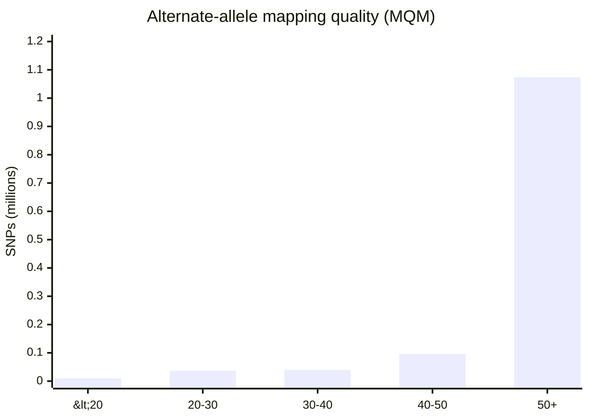
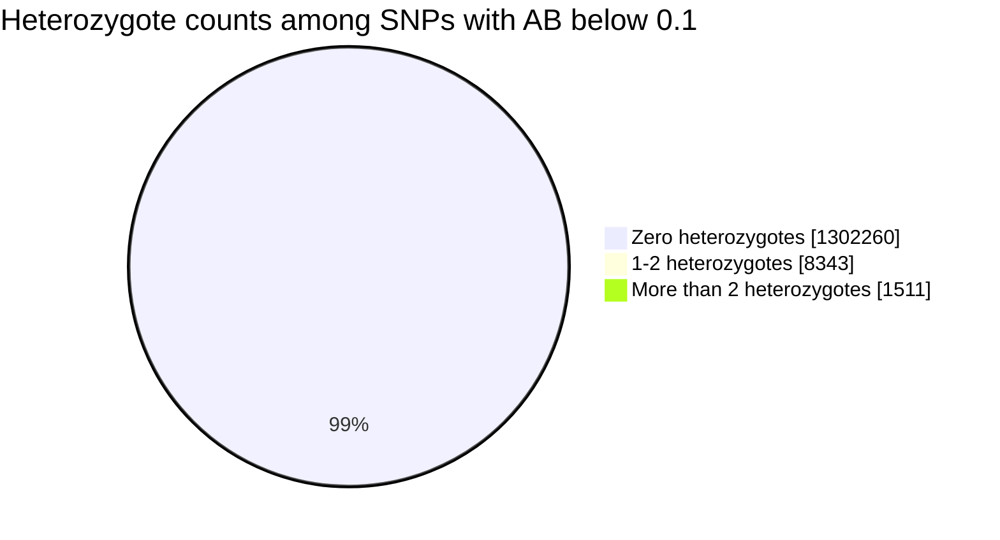
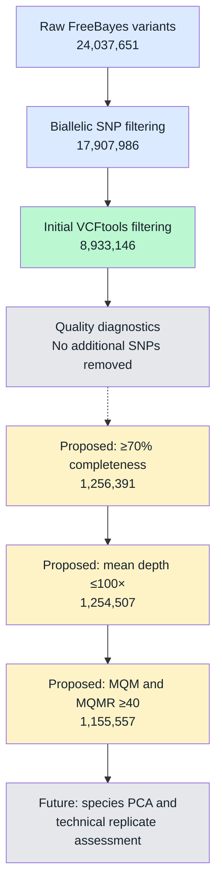
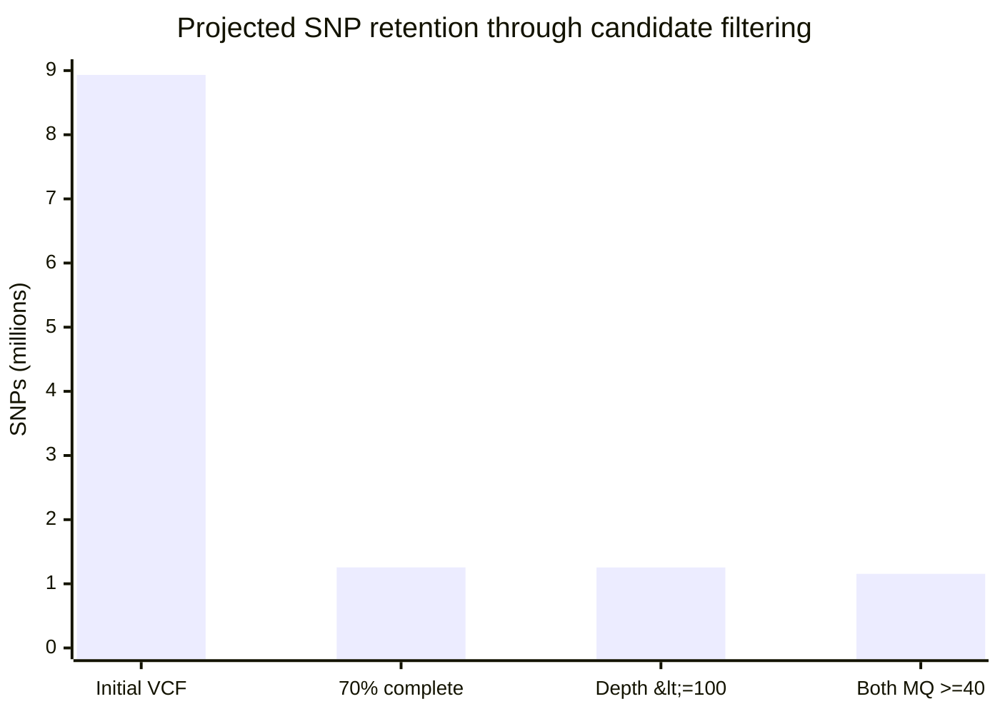
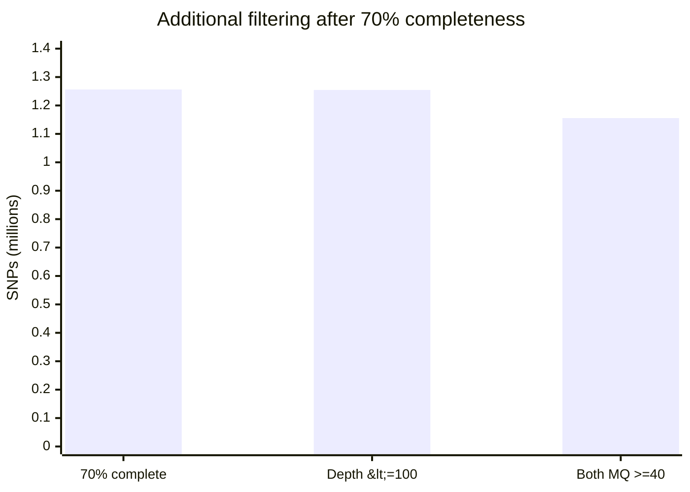
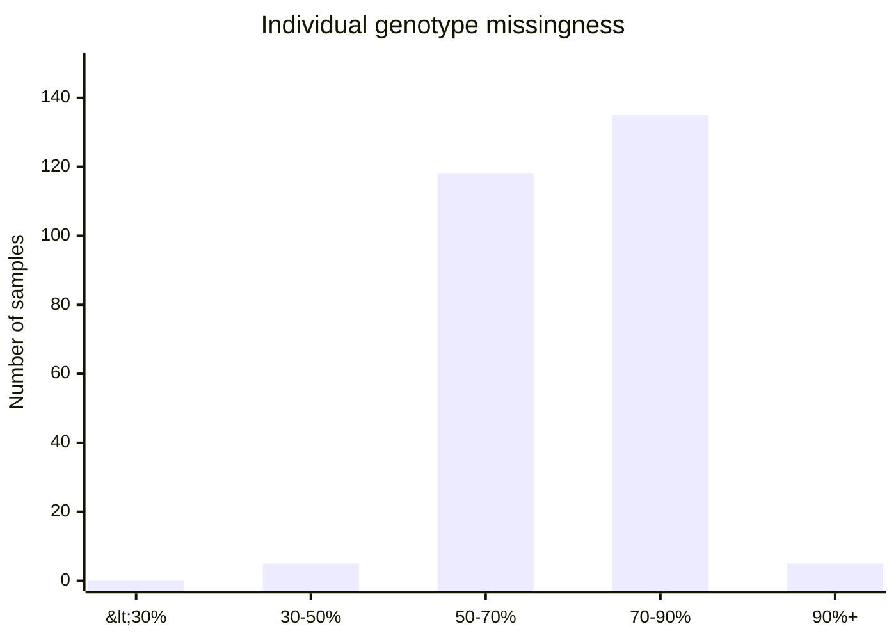
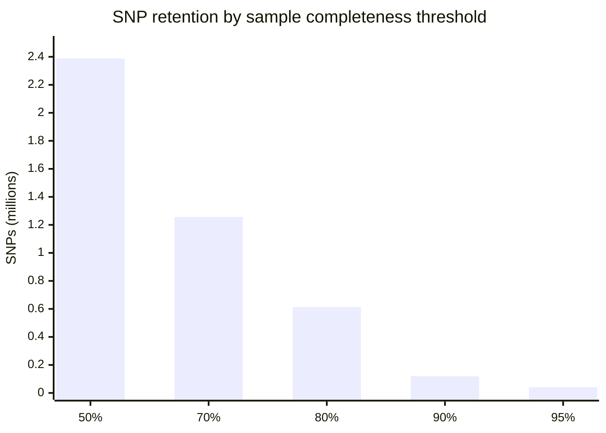
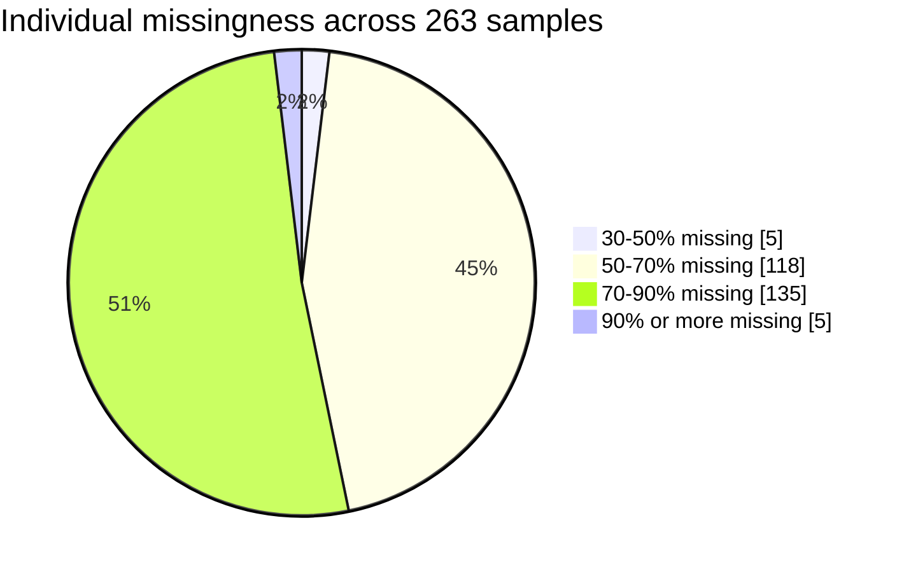

```{r setup, include=FALSE}
knitr::opts_chunk$set(
  echo = FALSE,
  warning = FALSE,
  message = FALSE
)

library(ggplot2)
```

# SNP Filtering Analysis Log

## Project: *Pocillopora acuta* ezRAD Seascape Genomics

**Started:** October 22, 2026  
**Status:** Initial SNP filtering planned / in progress  
**Repository:** [Pacuta_ezRAD_bioinformatics](https://github.com/sshedd/Pacuta_ezRAD_bioinformatics)

---

## 1. Objective

Filter raw SNPs generated by dDocent and FreeBayes to produce a high-quality nuclear SNP dataset suitable for population genetic analyses, species identification, technical-replicate assessment, principal component analysis (PCA), and subsequent seascape genomics.

All 263 individuals will be retained during SNP filtering.

After SNP filtering, PCA and technical-replicate comparisons will be used to evaluate species identification and sample quality. One suitable individual per sampling site will subsequently be selected for downstream seascape genomics analyses.

## 2. Starting Dataset

| Parameter | Value |
|---|---|
| Organism | *Pocillopora* spp., primarily *P. acuta* |
| Reference genome | *Pocillopora acuta* HIv1 |
| SNP caller | FreeBayes through dDocent v2.9.8 |
| Number of individuals | 263 |
| Raw variant sites | 24,037,651 |
| Input VCF | `TotalRawSNPs.vcf` |
| Input VCF size | Approximately 221 GB |
| SNP-calling completion | October 21, 2026 |

The input for filtering is the original `TotalRawSNPs.vcf`, rather than dDocent's automatically filtered `Final.recode.vcf`.

## 3. Software

All analyses are performed in the `ezRAD_env` conda environment.

| Software | Version |
|---|---|
| VCFtools | 0.1.17 |
| BCFtools | 1.23.1 |
| vcflib (`vcffilter`) | Installed; version not yet recorded |

## 4. Working Directory

Original dDocent output:

```text
/home/sshedd/working/pacuta/dDocent_min_tlen_fixmate_Pacuta/
```

SNP-filtering subdirectory:

```text
/home/sshedd/working/pacuta/dDocent_min_tlen_fixmate_Pacuta/SNP_filtering/
```

The original raw VCF will be preserved. Filtering outputs will be stored separately and named according to the filtering stage.

Available storage checked before filtering:

```text
Filesystem: /dev/sda1
Total:      1.5 TB
Available:  1.3 TB
Usage:      7%
```

## 5. Filtering Strategy

The primary filtering workflow follows the supplied ezRAD analysis guidelines, with additional consideration of filtering criteria used in a published sea cucumber seascape genomics study.

Planned filtering stages:

1. Initial technical filtering: biallelic SNPs, variant type, allele count, depth, and variant quality.
2. Examine individual missingness without removing samples.
3. Examine per-site missingness and mean sequencing depth.
4. Apply additional SNP-level quality filters, including allele frequency and read-support criteria.
5. Evaluate heterozygosity and potentially problematic loci.
6. Reduce linked or closely spaced SNPs where appropriate.
7. Produce a filtered dataset for PCA, species identification, and technical-replicate assessment.

**No individuals will be removed during the initial SNP-filtering workflow.**

Because sampling sites contain only 1–3 individuals, population-level MAF filters will not be applied using individual sampling sites as populations.

Thresholds for site missingness, MAF, heterozygosity, and linkage will be evaluated using the dataset and documented before application.

## 6. Initial SNP Filtering — BCFtools

### Purpose

Apply the initial SNP filters recommended in the ezRAD analysis document while retaining all 263 individuals.

| Filter | Setting | Purpose |
|---|---|---|
| Maximum alleles | 2 | Retain biallelic variants |
| Variant type | SNPs | Exclude indels |
| Minimum non-reference allele count | 1 | Exclude invariant reference sites |
| Maximum mean genotype depth | 2,000 | Remove extremely high-depth sites |
| Require homozygous genotype | Not applied | Retain all-heterozygous sites for later evaluation |

### Command

```bash
conda activate ezRAD_env

cd ~/working/pacuta/dDocent_min_tlen_fixmate_Pacuta

mkdir -p SNP_filtering
cd SNP_filtering

bcftools view \
    --max-alleles 2 \
    -v snps \
    -c 1:nref \
    -i 'MEAN(FORMAT/DP)<=2000' \
    ../TotalRawSNPs.vcf \
    -Oz \
    -o 01_biallelic_snps.vcf.gz
```

Compressed VCF output is used to reduce storage requirements.

### Verification commands

Run only after the filtering command completes successfully:

```bash
bcftools index -t 01_biallelic_snps.vcf.gz

bcftools index -n 01_biallelic_snps.vcf.gz

bcftools query -l 01_biallelic_snps.vcf.gz | wc -l
```

## 7. Next Filtering Stage — VCFtools

Following successful completion of the initial BCFtools stage, apply the following filters from the ezRAD analysis document:

- Minimum variant quality: `--minQ 20`
- Minimum minor allele count: `--mac 2`
- Minimum genotype depth: `--minDP 3`

## 8. Filtering Results Summary

### Table 1. SNP filtering and quality-control summary

| **Step** | **Analysis** | **Filters applied** | **SNPs retained** | **Individuals retained** | **Runtime** | **Status** |
|---|---|---|---|---|---|---|
| 0 | Raw FreeBayes variant calling | None | 24,037,651 | 263 | — | Complete |
| 1 | Initial BCFtools filtering | Biallelic SNPs; non-reference allele count ≥1; mean genotype depth ≤2,000 | 17,907,986 | 263 | Not recorded | Complete |
| 2 | Initial VCFtools filtering | `--minQ 20 --mac 2 --minDP 3` | 8,933,146 | 263 | 4,576 seconds (~76 min) | Complete |
| 3 | Individual missingness assessment | `--missing-indv` (diagnostic only) | 8,933,146 | 263 | 364 seconds (~6 min) | Complete |
| 4 | Per-site missingness assessment | `--missing-site` (diagnostic only) | 8,933,146 | 263 | 397 seconds (~7 min) | Complete |
| 5 | Per-site mean depth assessment | `--site-mean-depth` (diagnostic only) | 8,933,146 | 263 | 402 seconds (~7 min) | Complete |
| 5a | Mean depth among SNPs with ≥70% completeness | Combined site-missingness and mean-depth diagnostic files; no filtering applied | 1,256,391 SNPs assessed | 263 (unchanged) | Not recorded | Complete |
| 6 | Additional SNP filtering | MAF, site missingness, depth and other quality criteria to be determined | Pending | 263 planned | — | Not started |

**Important:** All 263 coral samples are being retained throughout SNP filtering. Individual selection will occur after PCA, species identification checks, and technical-replicate assessment. Diagnostic analyses do not modify the VCF or remove samples.

### Table 2. Individual missingness distribution

Calculated using VCFtools `--missing-indv` on 8,933,146 SNPs across 263 individuals.

| **Individual missingness** | **Number of individuals** | **Percentage** |
|---|---:|---:|
| Less than 10% | 0 | 0.0% |
| 10–30% | 0 | 0.0% |
| 30–50% | 5 | 1.9% |
| 50–70% | 118 | 44.9% |
| 70–90% | 135 | 51.3% |
| 90% or greater | 5 | 1.9% |
| **Total** | **263** | **100%** |

```{r individual-missingness, echo=FALSE, fig.width=8, fig.height=4}

library(ggplot2)

missingness <- data.frame(
  category = factor(
    c("<30%", "30–50%", "50–70%", "70–90%", "≥90%"),
    levels = c("<30%", "30–50%", "50–70%", "70–90%", "≥90%")
  ),
  individuals = c(0, 5, 118, 135, 5)
)

ggplot(missingness, aes(x = category, y = individuals)) +
  geom_col(fill = "#4682B4") +
  geom_text(aes(label = individuals), vjust = -0.4) +
  labs(
    title = "Individual genotype missingness",
    subtitle = "All 263 samples retained",
    x = "Missing genotype fraction",
    y = "Number of individuals"
  ) +
  theme_minimal()
```

**Interpretation:** Individual missingness was high across the dataset. A total of 253 individuals (96.2%) had at least 50% missing genotypes at this stage. This may reflect uneven SNP coverage among individuals and the effect of the minimum genotype depth filter (`--minDP 3`). No individuals were removed.

### Table 3. SNP completeness and potential retention thresholds

Calculated using VCFtools `--missing-site` on 8,933,146 SNPs across 263 individuals.

| **Minimum SNP genotyping rate** | **Equivalent maximum missingness** | **SNPs meeting threshold** | **Percentage of current SNPs** |
|---|---|---:|---:|
| ≥95% | ≤5% | 41,854 | 0.47% |
| ≥90% | ≤10% | 119,552 | 1.34% |
| ≥80% | ≤20% | 613,206 | 6.86% |
| ≥70% | ≤30% | 1,256,391 | 14.06% |
| ≥50% | ≤50% | 2,388,252 | 26.73% |

```{r snp-completeness, echo=FALSE, fig.width=8, fig.height=4}
completeness <- data.frame(
  threshold = factor(
    c("50%", "70%", "80%", "90%", "95%"),
    levels = c("50%", "70%", "80%", "90%", "95%")
  ),
  snps = c(2388252, 1256391, 613206, 119552, 41854)
)

ggplot(completeness, aes(x = threshold, y = snps / 1e6)) +
  geom_col(fill = "#2A9D8F") +
  geom_text(
    aes(label = format(snps, big.mark = ",", scientific = FALSE)),
    vjust = -0.4,
    size = 3.5
  ) +
  scale_y_continuous(
    limits = c(0, 2.7),
    expand = expansion(mult = c(0, 0))
  ) +
  labs(
    title = "SNP retention by sample completeness",
    x = "Minimum sample completeness",
    y = "SNPs retained (millions)"
  ) +
  theme_minimal()
```

**Interpretation:** A minimum genotyping rate of 70% would retain approximately 1.26 million SNPs before further filtering. This threshold is being considered because it balances SNP retention and completeness and is comparable to the sea cucumber seascape genomics workflow.

**Decision status:** A minimum genotyping rate of 70% (`--max-missing 0.70`) is the provisional preferred threshold, supported by the mean-depth assessment below. It has **not yet been applied** to the VCF.

### Table 4. Mean SNP depth distribution

Calculated using VCFtools `--site-mean-depth` on 8,933,146 SNPs across 263 individuals.

| **Mean SNP depth** | **Number of SNPs** | **Percentage of SNPs** |
|---|---:|---:|
| Less than 3× | 4,032,752 | 45.14% |
| 3–5× | 2,395,442 | 26.82% |
| 5–10× | 1,780,913 | 19.94% |
| 10–20× | 628,454 | 7.04% |
| 20–50× | 84,321 | 0.94% |
| 50–100× | 9,348 | 0.10% |
| ≥100× | 1,916 | 0.02% |
| **Total** | **8,933,146** | **100%** |

**Summary statistics:**

| **Metric** | **Value** |
|---|---:|
| Total SNPs assessed | 8,933,146 |
| Overall mean SNP depth | 4.753× |
| Minimum mean SNP depth | 1.128× |
| Maximum mean SNP depth | 1,014.75× |
| SNPs with mean depth below 5× | 6,428,194 (71.96%) |

**Interpretation:** Most SNPs had relatively low mean sequencing depth across the full dataset. Approximately 72% had a mean depth below 5×. However, low mean depth may partly reflect uneven coverage and high missingness across individuals rather than uniformly low depth at successfully genotyped sites.

The initial VCFtools filtering included `--minDP 3`, which masks individual genotypes below three reads. Therefore, mean SNP depth and individual genotype depth should not be interpreted as equivalent measurements.

### Table 5. Mean SNP depth among SNPs with ≥70% completeness

The site-missingness and mean-depth diagnostic files were compared to assess sequencing depth among SNPs genotyped in at least 70% of the 263 individuals.

This analysis was diagnostic only; no additional SNPs or individuals were removed.

| **Metric** | **Result** |
|---|---:|
| SNPs meeting ≥70% completeness | 1,256,391 |
| Average mean SNP depth | 12.227× |
| SNPs with mean depth below 3× | 0 |
| SNPs with mean depth 3–5× | 3,148 (0.25%) |
| SNPs with mean depth ≥5× | 1,253,243 (99.75%) |

**Interpretation:** SNPs meeting the provisional 70% completeness threshold had substantially higher mean depth than the full dataset (12.227× versus 4.753×). Nearly all SNPs in this subset (99.75%) had a mean depth of at least 5×.

This indicates that low mean depth across the full dataset is strongly associated with SNPs having higher missingness. Restricting analyses to SNPs with greater completeness may improve the overall coverage profile without requiring an additional minimum mean-depth filter.

**Filtering decision:** No additional minimum mean-depth threshold will be applied at this stage. The provisional 70% completeness threshold will be evaluated alongside minor allele frequency and other SNP-quality criteria before final filtering.

### Table 6. Output files generated

| **Analysis** | **Output file** | **Purpose** |
|---|---|---|
| Initial BCFtools filtering | `01_biallelic_snps.vcf.gz` | Biallelic SNP dataset after initial filtering |
| Initial VCFtools filtering | `02_initial_vcftools.vcf.gz` | Dataset after quality, minor allele count and genotype depth filters |
| Individual missingness | `03_individual_missingness.imiss` | Missing genotype proportion for each sample |
| Site missingness | `04_site_missingness.lmiss` | Missing genotype proportion for each SNP |
| Mean SNP depth | `04_site_mean_depth.ldepth.mean` | Mean sequencing depth for each SNP |

## 9. Additional Mean-Depth Assessment

### 9.1 Purpose

The initial mean-depth assessment showed that SNPs with at least 70% sample completeness generally had higher mean sequencing depth than the full SNP dataset.

We therefore examined the upper tail of the mean-depth distribution to determine whether unusually high-depth SNPs should be excluded.

Very high sequencing depth can sometimes indicate repetitive genomic regions, duplicated sequences, or reads from multiple genomic locations mapping to the same reference position. However, high depth alone does not establish that a SNP is erroneous.

### Table 7. Upper-depth tail among SNPs with ≥70% completeness

| Mean SNP depth | Number of SNPs above threshold |
|---|---:|
| >50× | 11,109 |
| >75× | 4,091 |
| >100× | 1,884 |
| >150× | 541 |
| >200× | 167 |

**Interpretation:** Only 1,884 of the 1,256,391 SNPs meeting the provisional 70% completeness threshold had mean depth greater than 100×, representing approximately 0.15% of these SNPs.

**Provisional filtering decision:** Consider applying a maximum mean-depth threshold of 100×.

**Reasoning:**

- Unusually high-depth SNPs may represent duplicated or repetitive genomic regions.
- The proposed threshold would remove only a small proportion of SNPs meeting the completeness requirement.
- A maximum-depth filter may reduce potentially problematic loci without substantially reducing the available SNP dataset.
- The 100× threshold is a pragmatic quality-control choice rather than a demonstrated biological boundary.

No additional minimum mean-depth threshold is proposed because the ≥70% completeness subset already has substantially improved mean depth.

**Status:** Diagnostic complete. Maximum mean-depth filter not yet applied.

## 10. FreeBayes Mapping-Quality Assessment

### 10.1 Purpose

Mapping quality indicates how confidently sequencing reads align to the reference genome.

Two FreeBayes INFO annotations were examined:

- `MQM`: Mean mapping quality of reads supporting the alternate allele.
- `MQMR`: Mean mapping quality of reads supporting the reference allele.

Examining both metrics is important because reads supporting the reference and alternate alleles may differ in mapping confidence.

### 10.2 Mapping quality across all initially filtered SNPs

The distribution of `MQM` was examined across all 8,933,146 SNPs in `02_initial_vcftools.vcf.gz`.

### Table 8. Alternate-allele mapping quality across all SNPs

| MQM range | Number of SNPs | Percentage |
|---|---:|---:|
| <20 | 96,582 | 1.1% |
| 20–30 | 298,545 | 3.3% |
| 30–40 | 482,484 | 5.4% |
| 40–50 | 896,227 | 10.0% |
| ≥50 | 7,159,308 | 80.1% |
| **Total** | **8,933,146** | **100%** |

**Interpretation:** Most SNPs had relatively high alternate-allele mapping quality. Approximately 80.1% had `MQM ≥50`.

### 10.3 Mapping quality among SNPs with ≥70% completeness

We repeated the assessment for SNPs genotyped in at least 70% of the 263 individuals.

### Table 9. Alternate-allele mapping quality among higher-completeness SNPs

| MQM range | Number of SNPs |
|---|---:|
| <20 | 10,308 |
| 20–30 | 36,603 |
| 30–40 | 39,913 |
| 40–50 | 96,047 |
| ≥50 | 1,073,520 |
| **Total** | **1,256,391** |

Approximately 85.4% of these SNPs had `MQM ≥50`.

#### Figure 1. Alternate-allele mapping quality among SNPs with ≥70% completeness



**Figure interpretation:** Most SNPs meeting the completeness threshold have high alternate-allele mapping quality. The higher-completeness subset also has a larger proportion of high-MQM SNPs than the full dataset.

### 10.4 Comparing reference and alternate mapping quality

We examined both `MQM` and `MQMR` among the 1,256,391 SNPs meeting the provisional completeness threshold.

### Table 10. SNP retention under alternative mapping-quality thresholds

| Required mapping quality for both alleles | SNPs failing | SNPs passing |
|---|---:|---:|
| ≥30 | 50,686 | 1,205,705 |
| ≥40 | 99,534 | 1,156,857 |
| ≥50 | 204,940 | 1,051,451 |

Additional diagnostic result:

**66,579 SNPs** had alternate-allele mapping quality more than 10 points below reference-allele mapping quality.

This represents approximately 5.3% of SNPs meeting the completeness threshold.

Such differences can indicate allele-specific mapping uncertainty, although they do not automatically establish that a variant is incorrect.

### 10.5 Mapping-quality filtering decision

**Provisional decision:** Require both `MQM ≥40` and `MQMR ≥40`.

**Reasoning:**

1. Both reference and alternate alleles should have reasonably confident mapping support.
2. Requiring both values to be at least 40 would retain approximately 92.1% of SNPs meeting the completeness threshold.
3. A threshold of 50 would remove substantially more SNPs.
4. The proposed threshold may reduce false-positive SNPs associated with ambiguous read alignments.
5. It balances quality control with retaining enough markers for PCA and species identification.

**Status:** Diagnostic complete. Mapping-quality filter not yet applied.

## 11. Allele-Balance Assessment

### 11.1 Purpose

Allele balance describes the relative representation of reference and alternate reads among heterozygous observations.

For a diploid heterozygous genotype, approximately balanced read support is generally expected, although sequencing depth, sampling variation, and alignment bias can cause deviations.

FreeBayes `AB` is a site-level annotation, rather than a direct measure of allele balance for each individual genotype.

### 11.2 Allele-balance distribution

The `AB` distribution was examined across all 8,933,146 initially filtered SNPs.

### Table 11. FreeBayes allele-balance distribution

| AB range | Number of SNPs |
|---|---:|
| <0.1 | 1,312,114 |
| 0.1–0.2 | 420,636 |
| 0.2–0.3 | 983,509 |
| 0.3–0.4 | 1,567,457 |
| 0.4–0.6 | 3,991,528 |
| 0.6–0.8 | 632,086 |
| >0.8 | 25,816 |
| **Total** | **8,933,146** |

Approximately 44.7% of SNPs had AB between 0.4 and 0.6.

However, 1,312,114 SNPs had AB below 0.1, prompting further investigation before choosing an allele-balance threshold.

### 11.3 Investigating SNPs with very low allele balance

Five SNPs with `AB <0.1` were inspected directly.

All five had `AB = 0` and no heterozygous genotype calls in the current VCF. Instead, they contained combinations of homozygous-reference genotypes (`0/0`), occasional homozygous-alternate genotypes (`1/1`), and missing genotypes (`./.`).

We then counted heterozygous genotype calls across all SNPs with `AB <0.1`.

### Table 12. Heterozygous genotype counts among SNPs with AB <0.1

| Heterozygous calls per SNP | Number of SNPs | Percentage |
|---|---:|---:|
| Zero | 1,302,260 | 99.25% |
| 1–2 | 8,343 | 0.64% |
| More than 2 | 1,511 | 0.12% |
| **Total** | **1,312,114** | **100%** |

#### Figure 2. Heterozygous genotype counts among low-AB SNPs



**Figure interpretation:** Approximately 99.25% of SNPs with very low AB had no heterozygous genotype calls in the current filtered VCF.

This is important because a SNP without heterozygous calls cannot be meaningfully evaluated for read balance within its currently observed heterozygotes.

An additional consideration is that FreeBayes calculated the original INFO annotations before VCFtools masked genotypes with depth below 3×. Therefore, the current genotype calls and original site-level AB annotations may not reflect exactly the same observations.

### 11.4 Allele-balance filtering decision

**Decision: Do not apply a blanket site-level AB filter at this stage.**

**Reasoning:**

1. Nearly all SNPs with AB below 0.1 have no heterozygous calls in the current VCF.
2. Low AB therefore does not necessarily indicate poorly balanced heterozygous genotypes.
3. SNPs without heterozygotes may still contain useful genetic variation.
4. Such SNPs may be informative for distinguishing *Pocillopora* species during PCA.
5. Applying a strict AB threshold could remove potentially valid markers unnecessarily.
6. If allele balance becomes a concern later, genotype-level allele-balance assessment would be more informative.

**Status:** Diagnostic complete. No blanket AB filter recommended.

## 12. Properly Paired Read Assessment

### 12.1 Purpose

FreeBayes provides two annotations describing properly paired read support:

- `PAIRED`: Fraction of alternate-allele observations supported by properly paired reads.
- `PAIREDR`: Fraction of reference-allele observations supported by properly paired reads.

Low values can sometimes indicate problematic alignments, although paired-read support also depends on library preparation and read processing.

### 12.2 Results

Both metrics were examined among SNPs meeting the provisional 70% sample-completeness threshold.

### Table 13. Properly paired read support

| Diagnostic | Number of SNPs |
|---|---:|
| SNPs with ≥70% completeness | 1,256,391 |
| Missing either paired-read annotation | 0 |
| Either allele paired fraction <0.5 | 0 |
| Either allele paired fraction <0.8 | 0 |
| Either allele paired fraction <0.9 | 0 |
| Both paired fractions ≥0.9 | 1,256,391 |

All candidate SNPs had both `PAIRED ≥0.9` and `PAIREDR ≥0.9`.

**Interpretation:** Properly paired read support was consistently high among the candidate SNPs.

Although this is reassuring, properly paired reads are not necessarily uniquely or correctly mapped reads. Mapping quality remains an important complementary measure.

### 12.3 Paired-read filtering decision

**Decision: Do not add a paired-read filter at this stage.**

**Reasoning:**

- All SNPs meeting the completeness threshold already have strong paired-read support.
- A threshold of 0.9 would remove no SNPs from the candidate dataset.
- Adding a filter that removes no SNPs would not improve the dataset.

**Status:** Diagnostic complete. No additional paired-read filter recommended.

## 13. Combined Candidate-Filter Assessment

### 13.1 Purpose

Before creating another filtered VCF, we calculated the combined effects of the proposed SNP-completeness, maximum-depth, and mapping-quality thresholds.

This is important because SNPs may fail more than one quality criterion. Adding removal counts from separate diagnostics could therefore overestimate the total number of SNPs excluded.

The proposed criteria are:

1. SNP completeness ≥70%.
2. Mean SNP depth ≤100×.
3. Alternate-allele mapping quality (`MQM`) ≥40.
4. Reference-allele mapping quality (`MQMR`) ≥40.

### Table 14. Combined projected SNP retention

| Filtering stage | SNPs remaining | SNPs removed at this stage |
|---|---:|---:|
| Current initially filtered VCF | 8,933,146 | — |
| SNP completeness ≥70% | 1,256,391 | 7,676,755 |
| Plus mean SNP depth ≤100× | 1,254,507 | 1,884 |
| Plus MQM ≥40 and MQMR ≥40 | **1,155,557** | **98,950** |

The depth and mapping-quality criteria together would exclude 100,834 SNPs after the completeness threshold.

Approximately 92.0% of SNPs meeting the 70% completeness threshold would survive the additional proposed filters.

### 13.2 Visualizing the combined filtering results

#### Figure 3. SNP filtering workflow



**Figure interpretation:** The first two filtering stages are complete. The later thresholds have been evaluated using diagnostics but have not yet been applied to generate a new VCF.

#### Figure 4. Projected SNP retention



**Figure interpretation:** The 70% completeness threshold has the largest effect on SNP retention. The proposed maximum-depth and mapping-quality thresholds remove comparatively few additional SNPs.

#### Figure 5. Effect of depth and mapping-quality filtering after the completeness threshold



**Figure interpretation:** After restricting SNPs to those present in at least 70% of samples, the maximum-depth threshold removes only 1,884 SNPs. The mapping-quality criteria then remove another 98,950 SNPs.

### 13.3 Candidate filtering decision

**Provisional decision:** Generate a candidate filtered VCF using the following thresholds:

| Criterion | Proposed threshold |
|---|---|
| SNP completeness | ≥70% |
| Mean SNP depth | ≤100× |
| Alternate-allele mapping quality | MQM ≥40 |
| Reference-allele mapping quality | MQMR ≥40 |
| Additional minimum mean depth | None |
| Site-level allele balance | No blanket filter |
| Properly paired read support | No additional filter |

**Reasoning:**

- The completeness threshold improves the overall depth profile while retaining more than 1.25 million SNPs.
- The maximum-depth filter removes a small number of unusually high-depth loci.
- The mapping-quality filters require reasonably confident read mapping for both alleles.
- The allele-balance diagnostic does not justify a blanket AB filter.
- The paired-read metrics already show strong support among all candidate SNPs.
- Approximately 1.16 million SNPs are projected to remain, providing a substantial candidate dataset for further evaluation.

**Important:** The projected SNP count is based on diagnostic calculations. The candidate filtered VCF has not yet been generated, and its actual SNP count must be verified.

## 14. Additional Visual Summaries

The following figures summarize earlier results from Sections 1–8. They are included here so that the original tables and descriptions can remain unchanged.

### Figure 6. Individual missingness across all 263 samples



**Interpretation:** Most samples have high missingness in the current VCF. Nevertheless, all 263 samples are being retained until species-identification PCA and technical-replicate comparisons are completed.

### Figure 7. SNP retention by minimum sample completeness



**Interpretation:** Increasing the minimum sample-completeness requirement substantially reduces the number of retained SNPs.

The provisional 70% threshold represents a compromise between retaining genetic markers and reducing missing data.

A stricter completeness threshold may be evaluated later as a sensitivity analysis for PCA.

## 15. Updated SNP Filtering Decision Summary

| Filtering criterion | Status | Reason |
|---|---|---|
| Biallelic SNPs | Applied | Exclude indels and multiallelic variants |
| Minimum variant quality ≥20 | Applied | Remove lower-quality variant calls |
| Minimum minor allele count ≥2 | Applied initially | Exclude variants with very low observed minor allele counts |
| Minimum genotype depth ≥3× | Applied | Mask low-depth genotypes |
| Individual missingness | Diagnostic only | Retain all individuals for species PCA and replicate comparisons |
| SNP completeness ≥70% | Provisional | Balance SNP retention with reduced missingness |
| Additional minimum mean depth | Not recommended | Higher-completeness SNPs already show improved depth |
| Maximum mean depth ≤100× | Provisional | Remove a small number of unusually high-depth loci |
| MQM ≥40 and MQMR ≥40 | Provisional | Require good mapping quality for both alleles |
| Site-level allele balance | No blanket filter | Low AB is strongly associated with zero heterozygous calls |
| PAIRED and PAIREDR | No additional filter | All candidate SNPs have paired-read fractions ≥0.9 |
| Global MAF | Pending | Compare suitable thresholds before final downstream analyses |
| Heterozygosity filtering | Pending | Evaluate problematic loci without prematurely excluding species-informative SNPs |
| SNP thinning / linkage | Pending | Reduce non-independence where appropriate for PCA |
| Sample removal | Not permitted at this stage | Complete species identification and technical replicate assessment first |

## 16. Reproducibility Notes

The following points are important for interpreting and reproducing these analyses:

- All diagnostics were performed using `02_initial_vcftools.vcf.gz`, unless otherwise stated.
- This VCF contains 8,933,146 SNPs and 263 individuals.
- The original `TotalRawSNPs.vcf` remains preserved.
- The candidate completeness, maximum-depth, and mapping-quality filters have not yet been applied.
- The site-missingness file `04_site_missingness.lmiss` contains six columns; `F_MISS` is column 6.
- The site-mean-depth file `04_site_mean_depth.ldepth.mean` contains four columns; `MEAN_DEPTH` is column 3.
- Combined diagnostics used chromosome and position checks to verify that corresponding rows from different files referred to the same SNP.
- FreeBayes INFO annotations were generated during variant calling and may not fully reflect subsequent genotype masking by VCFtools.
- All 263 coral samples remain retained.
- No population-level MAF filters will be applied using individual sampling sites as populations because sampling sites contain only 1–3 individuals.
- Global MAF thresholds of 0.01 and 0.05 remain under consideration.
- The projected SNP counts are diagnostic estimates, not verified counts from a newly generated VCF.
- All Mermaid figures contain their numerical data directly in the Markdown code and do not require separate image files.

## 17. Next Planned Analyses

1. Generate a candidate filtered VCF using the provisional SNP-completeness, maximum-depth, and mapping-quality thresholds.
2. Confirm the resulting SNP count and verify that all 263 individuals remain present.
3. Examine global minor allele frequency and genotype heterozygosity.
4. Evaluate SNP thinning or linkage disequilibrium pruning for PCA.
5. Perform PCA for species identification.
6. Compare technical replicates and assess sample consistency.
7. Select appropriate individuals for downstream seascape genomics, targeting one suitable individual per sampling site.
8. Document any further filtering decisions, parameter changes, software commands, runtimes, and SNP counts.

**Current status:** Initial SNP filtering and additional quality diagnostics are complete. The next candidate filtering step has been evaluated but not yet executed. All 263 individuals remain retained.

