SNP Filtering Analysis Log
================
2026-10-27

# SNP Filtering Analysis Log

## Project: *Pocillopora acuta* ezRAD Seascape Genomics

**Started:** October 22, 2026  
**Status:** Initial SNP filtering planned / in progress  
**Repository:**
[Pacuta_ezRAD_bioinformatics](https://github.com/sshedd/Pacuta_ezRAD_bioinformatics)

------------------------------------------------------------------------

## Starting Dataset

| Parameter              | Value                                    |
|------------------------|------------------------------------------|
| Organism               | *Pocillopora* spp., primarily *P. acuta* |
| Reference genome       | *Pocillopora acuta* HIv1                 |
| SNP caller             | FreeBayes through dDocent v2.9.8         |
| Number of individuals  | 263                                      |
| Raw variant sites      | 24,037,651                               |
| Input VCF              | `TotalRawSNPs.vcf`                       |
| Input VCF size         | Approximately 221 GB                     |
| SNP-calling completion | October 21, 2026                         |

The input for filtering is the original `TotalRawSNPs.vcf`, rather than 
dDocent’s automatically filtered `Final.recode.vcf`.

## Software

All analyses are performed in the `ezRAD_env` conda environment.

| Software             | Version                             |
|----------------------|-------------------------------------|
| VCFtools             | 0.1.17                              |
| BCFtools             | 1.23.1                              |
| vcflib (`vcffilter`) |  ??                                 |

##  Working Directory

Fixing fixmate issue output:

``` text
/home/sshedd/working/pacuta/dDocent_2/
```

Fixing fixmate issue output:

``` text
/home/sshedd/working/pacuta/dDocent_min_tlen_fixmate_Pacuta/
```

SNP-filtering subdirectory:

``` text
/home/sshedd/working/pacuta/dDocent_min_tlen_fixmate_Pacuta/SNP_filtering/
```

## 1. Initial SNP Filtering — BCFtools

### Purpose

Apply the initial SNP filters recommended in the ezRAD analysis document
while retaining all 263 individuals.

| Filter | Setting | Purpose |
|----|----|----|
| Maximum alleles | 2 | Retain biallelic variants |
| Variant type | SNPs | Exclude indels |
| Minimum non-reference allele count | 1 | Exclude invariant reference sites |
| Maximum mean genotype depth | 2,000 | Remove extremely high-depth sites |
| Require homozygous genotype | Not applied | Retain all-heterozygous sites for later evaluation |

### Command

``` bash
bcftools view \
    --max-alleles 2 \
    -v snps \
    -c 1:nref \
    -i 'MEAN(FORMAT/DP)<=2000' \
    ../TotalRawSNPs.vcf \
    -Oz \
    -o 01_biallelic_snps.vcf.gz
```

## Filtering Results Summary

### Table 1. SNP filtering and quality-control summary

| **Step** | **Analysis** | **Filters applied** | **SNPs retained** | **Individuals retained** | **Runtime** | **Status** |
|----|----|----|----|----|----|----|
| 0 | Raw FreeBayes variant calling | None | 24,037,651 | 263 | — | Complete |
| 1 | Initial BCFtools filtering | Biallelic SNPs; non-reference allele count ≥1; mean genotype depth ≤2,000 | 17,907,986 | 263 | Not recorded | Complete |
| 2 | Initial VCFtools filtering | `--minQ 20 --mac 2 --minDP 3` | 8,933,146 | 263 | 4,576 seconds (~76 min) | Complete |
| 3 | Individual missingness assessment | `--missing-indv` (diagnostic only) | 8,933,146 | 263 | 364 seconds (~6 min) | Complete |
| 4 | Per-site missingness assessment | `--missing-site` (diagnostic only) | 8,933,146 | 263 | 397 seconds (~7 min) | Complete |
| 5 | Per-site mean depth assessment | `--site-mean-depth` (diagnostic only) | 8,933,146 | 263 | 402 seconds (~7 min) | Complete |
| 5a | Mean depth among SNPs with ≥70% completeness | Combined site-missingness and mean-depth diagnostic files; no filtering applied | 1,256,391 SNPs assessed | 263 (unchanged) | Not recorded | Complete |
| 6 | Additional SNP filtering | MAF, site missingness, depth and other quality criteria to be determined | Pending | 263 planned | — | Not started |

### 2. Assess Individual Missingness

**Important:** All 263 coral samples are being retained throughout SNP
filtering. Individual selection will occur after PCA, species
identification checks, and technical-replicate assessment. Diagnostic
analyses do not modify the VCF or remove samples.

### Table 2. Individual missingness distribution

Calculated using VCFtools `--missing-indv` on 8,933,146 SNPs across 263
individuals.

| **Individual missingness** | **Number of individuals** | **Percentage** |
|----------------------------|--------------------------:|---------------:|
| Less than 10%              |                         0 |           0.0% |
| 10–30%                     |                         0 |           0.0% |
| 30–50%                     |                         5 |           1.9% |
| 50–70%                     |                       118 |          44.9% |
| 70–90%                     |                       135 |          51.3% |
| 90% or greater             |                         5 |           1.9% |
| **Total**                  |                   **263** |       **100%** |

## Individual Missingness Filtering: Removal of Five Individuals

### Rationale

Following a discussion with my advisor, we decided to remove individuals with greater than 90% missing genotype data before continuing site-level SNP filtering. Individuals with extremely high missingness contribute little usable genotype information and may influence the distribution of site missingness across the dataset.

Individual missingness was previously calculated using VCFtools from `02_initial_vcftools.vcf.gz`, which contained **263 individuals and 8,933,146 SNPs**. The resulting `03_individual_missingness.imiss` file was examined to identify individuals with at least 90% missing genotypes.

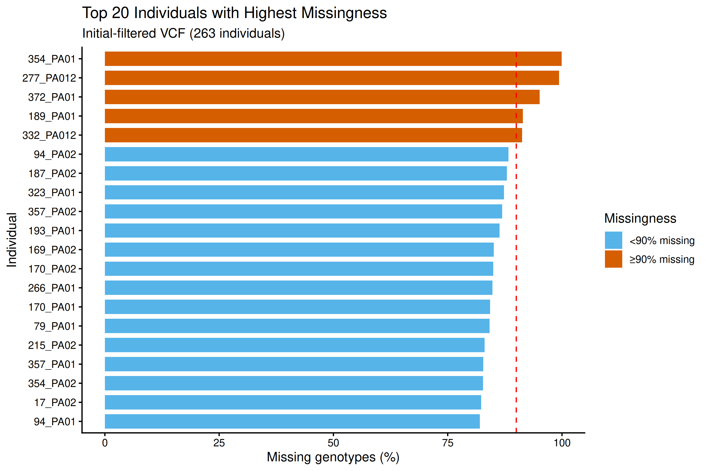

### Individuals identified for removal

Five individuals exceeded the missingness threshold:

| Individual | Proportion missing (`F_MISS`) | Percent missing |
|---|---:|---:|
| 189_PA01 | 0.914451 | 91.45% |
| 277_PA012 | 0.993308 | 99.33% |
| 332_PA012 | 0.912504 | 91.25% |
| 354_PA01 | 0.999562 | 99.96% |
| 372_PA01 | 0.950981 | 95.10% |

Two of these individuals (`277_PA012` and `332_PA012`) are technical replicate samples. Their exclusion will be accounted for in subsequent technical replicate analyses.

### Creating the exclusion list

The five sample IDs were saved in `07_high_missingness_samples.txt`:

```bash
printf '%s\n' \
  189_PA01 \
  277_PA012 \
  332_PA012 \
  354_PA01 \
  372_PA01 \
  > 07_high_missingness_samples.txt
```

### Removing individuals from the VCF

The five individuals were excluded directly from the initial-filtered VCF using `bcftools`. This avoids modifying the original FASTQ or BAM files or repeating the variant-calling pipeline.

```bash
bcftools view \
  -S ^07_high_missingness_samples.txt \
  -Oz \
  -o 07_initial_filtered_258ind.vcf.gz \
  02_initial_vcftools.vcf.gz \
  2> 07_remove_samples.log
```

The `-S ^` option instructs `bcftools` to exclude the individuals listed in the text file. The resulting VCF retains the remaining individuals and the original variant records.

The original 263-individual VCF was preserved for reproducibility.

### Input file integrity

An earlier attempt to remove the five individuals from `05_initial_vcftools_renamed.vcf.gz` failed with a BGZF read error, indicating a problem reading the compressed file.

The earlier file, `02_initial_vcftools.vcf.gz`, was subsequently tested:

```bash
bgzip -t 02_initial_vcftools.vcf.gz
echo $?
```

The test returned exit code `0`, indicating that the input passed the BGZF compression integrity check. Therefore, the sample exclusion was redirected to this earlier VCF.

### Verification of the filtered VCF

The expected output contains **258 individuals** and **8,933,146 SNP records**, because this step removes samples without applying additional site-level filters.

The following commands are used to verify the output:

```bash
bcftools index -t 07_initial_filtered_258ind.vcf.gz

bgzip -t 07_initial_filtered_258ind.vcf.gz
echo "Integrity test exit code: $?"

bcftools query -l 07_initial_filtered_258ind.vcf.gz | wc -l

bcftools index -n 07_initial_filtered_258ind.vcf.gz
```

These checks confirm file integrity, the number of retained individuals, and the number of variant records. **Final verification results should be recorded after the commands complete successfully.**

### 2: Assessing site missingness

## Site Missingness Analysis Following Individual Filtering

### Objective

Following the removal of five individuals with greater than 90% missing genotype data, site missingness was recalculated to evaluate the distribution of missing genotypes across SNPs and select an appropriate site-completeness threshold.

The updated dataset contained **258 individuals and 8,933,146 SNPs**.

### Calculating Site Missingness

Site missingness was calculated using VCFtools:

```bash
vcftools \
  --gzvcf 07_initial_filtered_258ind.vcf.gz \
  --missing-site \
  --out 08_site_missingness_258ind
```

The resulting `08_site_missingness_258ind.lmiss` file contained the proportion of missing genotypes (`F_MISS`) at each SNP.

VCFtools confirmed that 258 individuals and 8,933,146 sites were included in the analysis.

### Visualizing the Distribution

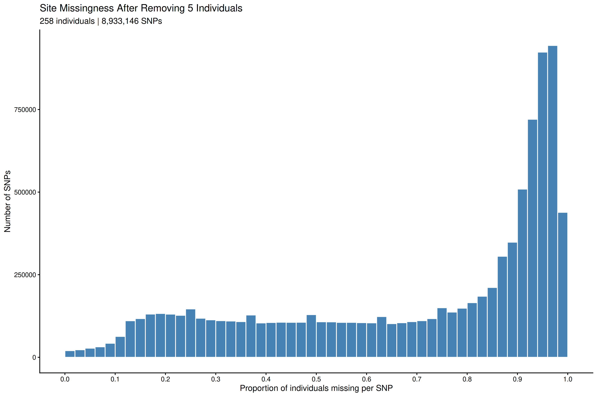

```

```

| Maximum site missingness | Minimum completeness | SNPs retained | Percentage retained |
|---|---|---:|---:|
| 10% | 90% | 144,403 | 1.62% |
| 20% | 80% | 698,614 | 7.82% |
| **30%** | **70%** | **1,334,122** | **14.93%** |
| 40% | 60% | 1,894,520 | 21.21% |
| 50% | 50% | 2,446,666 | 27.39% |
| 60% | 40% | 2,977,251 | 33.33% |
| 70% | 30% | 3,518,930 | 39.39% |

### Filtering Decision

A minimum site-completeness threshold of **70%** (maximum site missingness of 30%) was selected for subsequent SNP filtering.

This threshold was chosen as a balance between retaining a substantial number of SNPs and reducing missing genotype data. It retains approximately **1.33 million SNPs (14.93%)** from the initial-filtered dataset.

Although the histogram did not reveal a clear natural breakpoint, 70% completeness provides a reasonable working threshold for downstream population genomic analyses.

**Decision:** Apply a minimum site completeness of 70% to the 258-individual dataset.

**Status:** Threshold selected; filtering will be performed in the next step.

### 3. Invariant site check 

## Post-Individual-Removal MAC Reassessment

Following removal of five individuals with ≥90% missing genotypes and application of the 70% site-completeness threshold, the resulting VCF contained **258 individuals and 1,334,122 SNPs**.

Although a minor allele count (MAC) threshold of ≥2 had been applied during initial SNP filtering, removing individuals can change allele counts and cause previously polymorphic sites to become invariant or fall below the original MAC threshold.

### Checking for invariant sites

The number of SNPs with at least one observed minor allele was calculated using:

```bash
bcftools view \
  -c 1:minor \
  -H 09_site_completeness_70.vcf.gz | wc -l
```

**Result:** 1,334,010 SNPs retained at MAC ≥1.

Therefore, **112 sites** no longer contained an observed minor allele after individual removal.

A second diagnostic evaluated the original MAC ≥2 criterion:

```bash
bcftools view \
  -c 2:minor \
  -H 09_site_completeness_70.vcf.gz | wc -l
```

**Result:** 1,332,396 SNPs retained.

| Category | Number of SNPs |
|---|---:|
| SNPs before MAC reassessment | 1,334,122 |
| Invariant sites (MAC = 0) | 112 |
| Singleton minor alleles (MAC = 1) | 1,614 |
| Total sites failing MAC ≥2 | 1,726 |
| **SNPs satisfying MAC ≥2** | **1,332,396** |

Only 0.13% of SNPs failed the reassessed MAC ≥2 threshold.

### Reapplying the MAC filter

The MAC ≥2 criterion was reapplied to ensure that retained SNPs continued to satisfy the original filtering requirement.

```bash
bcftools view \
  -c 2:minor \
  -Oz \
  -o 10_site70_mac2.vcf.gz \
  09_site_completeness_70.vcf.gz

bcftools index -t 10_site70_mac2.vcf.gz
```

**Output:** `10_site70_mac2.vcf.gz`

**SNPs retained:** 1,332,396  
**Individuals retained:** 258

This VCF was used for subsequent SNP quality assessments.

---

## Examination of Mean Site Depth

Mean sequencing depth was examined to identify low-coverage SNPs and unusually high-depth sites that could potentially represent repetitive genomic regions or mapping artifacts.

The mean site-depth distribution was calculated using VCFtools:

```bash
vcftools \
  --gzvcf 10_site70_mac2.vcf.gz \
  --site-mean-depth \
  --out 11_site_mean_depth_258ind_site70_mac2
```

**Output file:** `11_site_mean_depth_258ind_site70_mac2.ldepth.mean`

VCFtools confirmed that all 258 individuals and 1,332,396 SNPs were included. The output contained 1,332,397 lines, including the header.

### Visualizing mean site depth in R

```r
library(ggplot2)

depth <- read.table(
  "11_site_mean_depth_258ind_site70_mac2.ldepth.mean",
  header = TRUE
)

ggplot(depth, aes(MEAN_DEPTH)) +
  geom_freqpoly(binwidth = 5) +
  scale_y_continuous(trans = "log10") +
  labs(
    title = "Mean Site Depth Distribution",
    x = "Mean site depth (×)",
    y = "Number of SNPs (log10 scale)"
  ) +
  theme_classic()
```
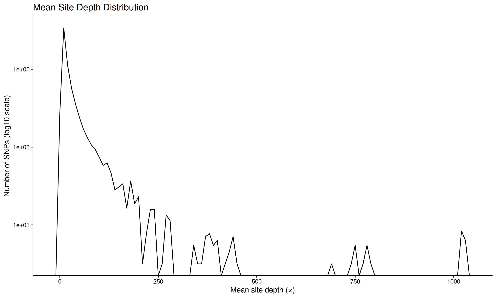

The frequency polygon revealed a strong peak at relatively low mean sequencing depth and a long tail containing a small number of exceptionally high-depth SNPs.

### Mean site-depth summary

| Statistic | Mean site depth |
|---|---:|
| Minimum | 4.296× |
| First quartile | 8.567× |
| Median | 10.089× |
| Mean | 12.015× |
| Third quartile | 12.344× |
| Maximum | 1,026.350× |

The median mean site depth was approximately 10×, with the middle 50% of SNPs between approximately 8.6× and 12.3×.

### Evaluating maximum mean-depth thresholds

The number of SNPs exceeding several potential maximum mean-depth thresholds was calculated in R:

```r
thresholds <- c(50, 100, 200, 500)

data.frame(
  Max_Mean_Depth = thresholds,
  SNPs_Above = sapply(
    thresholds,
    function(x) sum(depth$MEAN_DEPTH > x)
  ),
  Percent_Above = round(
    sapply(
      thresholds,
      function(x) mean(depth$MEAN_DEPTH > x) * 100
    ),
    4
  )
)
```

| Maximum mean depth | SNPs exceeding threshold | Percentage exceeding threshold |
|---|---:|---:|
| 50× | 11,335 | 0.8507% |
| 100× | 1,898 | 0.1425% |
| 200× | 152 | 0.0114% |
| 500× | 21 | 0.0016% |

### Depth-filtering decision

**Proposed maximum mean depth: 500×.**

A maximum mean site depth of 500× was selected as a conservative upper threshold, consistent with the ezRAD analysis document. Only 21 SNPs (0.0016%) exceeded this value.

No additional minimum mean-depth threshold was selected at this stage because the primary depth distribution was relatively low and a minimum per-genotype depth of 3× had already been applied during initial filtering.

**Status:** Depth thresholds selected but not yet applied to the VCF.

---

## Evaluation of Global Minor Allele Frequency (MAF)

Minor allele frequency was examined to determine an appropriate threshold for excluding rare variants while retaining genetic variation potentially relevant to individual-based seascape genomics analyses.

Because sampling was individual-based, with only 1–2 individuals per sampling site, population-specific MAF filtering was not considered appropriate. Instead, allele frequencies were calculated across all 258 retained individuals (global MAF).

### Calculating allele frequencies

```bash
vcftools \
  --gzvcf 10_site70_mac2.vcf.gz \
  --freq2 \
  --out 12_maf_distribution
```

**Output file:** `12_maf_distribution.frq`

VCFtools reported allele-frequency statistics for all 1,332,396 SNPs across 258 individuals.

### Importing and calculating MAF in R

The VCFtools frequency file contained six data columns but only five header labels. To avoid an R import error caused by repeated scaffold names being interpreted as row names, the original header was skipped and column names were assigned manually.

```r
library(ggplot2)

maf <- read.table(
  "12_maf_distribution.frq",
  header = FALSE,
  skip = 1,
  col.names = c(
    "CHROM", "POS", "N_ALLELES",
    "N_CHR", "FREQ1", "FREQ2"
  )
)

maf$MAF <- pmin(maf$FREQ1, maf$FREQ2)

summary(maf$MAF)
```

The smaller of the two allele frequencies was used as the MAF for each biallelic SNP.

### Visualizing the MAF distribution

```r
ggplot(maf, aes(x = MAF)) +
  geom_freqpoly(
    binwidth = 0.01,
    color = "steelblue"
  ) +
  geom_vline(
    xintercept = 0.05,
    linetype = "dashed",
    color = "red"
  ) +
  labs(
    title = "Minor Allele Frequency Distribution",
    subtitle = "258 individuals | 1,332,396 SNPs",
    x = "Minor allele frequency",
    y = "Number of SNPs"
  ) +
  theme_classic()
```
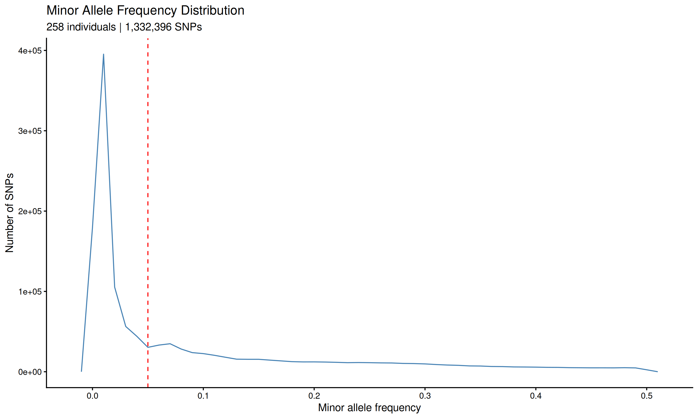

### Comparison of candidate global MAF thresholds

Several MAF thresholds were evaluated without removing SNPs from the VCF:

```r
thresholds <- c(0.01, 0.02, 0.03, 0.05)

data.frame(
  Min_MAF = thresholds,
  SNPs_Retained = sapply(
    thresholds,
    function(x) sum(maf$MAF >= x, na.rm = TRUE)
  ),
  Percent_Retained = round(
    sapply(
      thresholds,
      function(x) mean(maf$MAF >= x, na.rm = TRUE) * 100
    ),
    2
  )
)
```

**Table. SNP retention under alternative global MAF thresholds.**

| Minimum global MAF | SNPs retained | SNPs removed | Retained (%) |
|---|---:|---:|---:|
| 0.01 | 879,199 | 453,197 | 65.99 |
| 0.02 | 687,360 | 645,036 | 51.59 |
| 0.03 | 624,857 | 707,539 | 46.90 |
| 0.05 | 536,457 | 795,939 | 40.26 |

All comparisons were based on the same input dataset of 1,332,396 SNPs.

A global MAF threshold of 0.05 would remove approximately 59.74% of SNPs, whereas a threshold of 0.01 would retain approximately 65.99%.

### MAF-filtering decision

**Selected global MAF threshold: ≥0.01.**

The less restrictive threshold of 0.01 was selected to balance the exclusion of very rare variants with retention of potentially informative genetic variation. Because the study examines genotype–environment relationships across individually sampled coral colonies, preserving variants that may be geographically restricted was considered important.

The selected threshold is expected to retain **879,199 SNPs**, approximately 342,742 more than a global MAF threshold of 0.05.

**Status:** MAF ≥0.01 selected; final retention count should be confirmed from the filtered VCF.

---

## Hardy–Weinberg Equilibrium (HWE) Filtering Decision

**HWE filtering will not be applied.**

*Pocillopora acuta* exhibits both sexual and asexual reproduction, and the study system may include triploid individuals. These biological characteristics can violate assumptions underlying conventional diploid HWE tests.

Furthermore, departures from HWE may reflect population structure, reproductive biology, or selection and are not necessarily indicators of poor SNP quality. Removing such loci could eliminate variation relevant to seascape genomics.

Therefore, HWE deviation will not be used as a SNP exclusion criterion.

---

### Application of Maximum Mean Site Depth Filter (500×)

Following global MAF filtering, a maximum mean site depth threshold of 500× was applied to exclude exceptionally high-coverage SNPs that could potentially reflect repetitive genomic regions or mapping artifacts.

No additional minimum mean-depth threshold was applied because the mean site-depth distribution was relatively low and a minimum per-genotype depth of 3× had already been used during initial filtering.

```bash
vcftools \
  --gzvcf 13_global_maf001.vcf.gz \
  --max-meanDP 500 \
  --recode \
  --recode-INFO-all \
  --stdout \
  2> 14_max_meanDP500.log \
| bgzip -c > 14_maf001_maxmeanDP500.vcf.gz
```

**Filtering results:**

| Metric | Result |
|---|---:|
| Input SNPs | 879,199 |
| SNPs removed | 13 |
| SNPs retained | 879,186 |
| Individuals retained | 258 |
| Maximum mean site depth | 500× |

**Output:** `14_maf001_maxmeanDP500.vcf.gz`

The filter removed only 0.0015% of SNPs, retaining nearly all markers while excluding the most extreme high-depth outliers.

### Allele-Length Filtering: Removal of Multinucleotide Alleles

Although the initial filtering pipeline selected SNPs using `bcftools -v snps`, additional inspection identified records with reference or alternate alleles longer than one nucleotide.

The VCF header contained an `INFO/LEN` annotation. However, allele lengths were assessed directly from the REF and ALT fields to ensure that only single-nucleotide alleles were retained.

```bash
# Count records containing alleles longer than one nucleotide
bcftools view \
  -i 'strlen(REF)!=1 || strlen(ALT)!=1' \
  -H 14_maf001_maxmeanDP500.vcf.gz \
| wc -l

# Remove these records
bcftools view \
  -e 'strlen(REF)!=1 || strlen(ALT)!=1' \
  -Oz \
  -o 15_maf001_maxmeanDP500_LEN1.vcf.gz \
  14_maf001_maxmeanDP500.vcf.gz

bcftools index -t 15_maf001_maxmeanDP500_LEN1.vcf.gz
```

**Filtering results:**

| Metric | Result |
|---|---:|
| Input sites | 879,186 |
| Sites excluded | 39,377 (4.48%) |
| SNPs retained | 839,809 |
| Individuals retained | 258 |
| Remaining records with allele length ≠ 1 | 0 |

**Output:** `15_maf001_maxmeanDP500_LEN1.vcf.gz`

This step ensured that all retained variants were represented as single-nucleotide substitutions, improving compatibility with downstream population genomic and seascape genomic analyses.

## 16. Allele-Balance Assessment and Filtering

Following the removal of alleles longer than one base, the dataset contained **839,809 SNPs across 258 individuals**.

Allele balance (AB) was evaluated to identify SNPs exhibiting unequal support from reads associated with reference and alternate alleles in heterozygous genotype calls. Substantial allele imbalance can be associated with sequencing errors, mapping artifacts, or other complications in variant calling.

Because *Pocillopora acuta* can exhibit clonality and potentially variable ploidy, AB filtering was evaluated separately from Hardy–Weinberg equilibrium filtering.

### 16.1. Extract allele-balance values

Allele-balance values were extracted from the VCF using:

```bash
bcftools query \
  -f '%INFO/AB\n' \
  15_maf001_maxmeanDP500_LEN1.vcf.gz \
  > 16_allele_balance_values.txt
```

The distribution was examined in R:

```r
library(ggplot2)

ab <- read.table(
  "16_allele_balance_values.txt",
  header = FALSE,
  col.names = "AB",
  na.strings = "."
)

summary(ab$AB)

ggplot(ab, aes(x = AB)) +
  geom_histogram(
    binwidth = 0.02,
    fill = "steelblue",
    color = "white"
  ) +
  geom_vline(
    xintercept = c(0.25, 0.75),
    linetype = "dashed",
    color = "red"
  ) +
  labs(
    title = "Allele-Balance Distribution",
    subtitle = "258 individuals | 839,809 SNPs",
    x = "Allele balance (AB)",
    y = "Number of SNPs"
  ) +
  theme_classic()
```

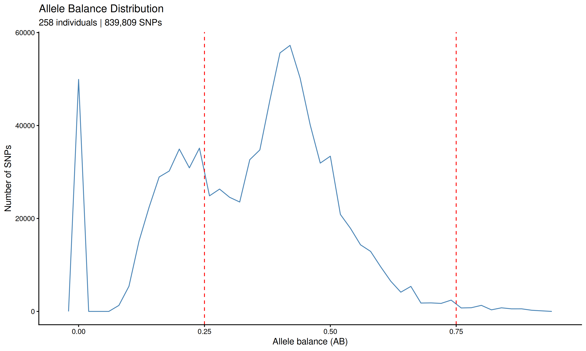

### 16.2. Evaluate the proposed AB filter

The ezRAD filtering workflow specifies the following criterion:

```text
(AB > 0.25 AND AB < 0.75) OR AB < 0.01
```

This retains SNPs with intermediate allele-balance values and includes a special exception for values below 0.01.

The exception was retained to reproduce the selected ezRAD filtering criterion, although its biological justification for *P. acuta* remains uncertain. In particular, AB values near zero should not automatically be interpreted as evidence of reliable allele balance.

The following SNP counts were obtained:

| AB category | SNP count | Percentage | Filter outcome |
|---|---:|---:|---|
| AB < 0.01 | 49,923 | 5.94% | Retained |
| 0.01 ≤ AB ≤ 0.25 | 204,345 | 24.33% | Removed |
| 0.25 < AB < 0.75 | 578,479 | 68.88% | Retained |
| AB ≥ 0.75 | 7,062 | 0.84% | Removed |
| **Total** | **839,809** | **100%** | |

Overall, the proposed AB filter retained **628,402 SNPs (74.83%)** and removed **211,407 SNPs (25.17%)**.

### 16.3. Apply allele-balance filtering

The filter was applied using:

```bash
bcftools view \
  -i '(INFO/AB>0.25 && INFO/AB<0.75) || INFO/AB<0.01' \
  -Oz \
  -o 16_allele_balance_filtered.vcf.gz \
  15_maf001_maxmeanDP500_LEN1.vcf.gz

bcftools index -t 16_allele_balance_filtered.vcf.gz
```

*Note: The VCF was initially generated under the filename `17_allele_balance_filtered.vcf.gz` and subsequently renamed to `16_allele_balance_filtered.vcf.gz` to align file numbering with the filtering stages.*

The retained SNP count was confirmed as **628,402**, with **258 individuals** remaining.

**Filtering decision:** Apply the ezRAD AB criterion, retaining 628,402 SNPs for subsequent mapping-quality filtering.

---

## 17. Mapping-Quality Assessment and Filtering

Mapping-quality filtering was performed **after allele-balance filtering** using `16_allele_balance_filtered.vcf.gz`, containing **628,402 SNPs across 258 individuals**.

The FreeBayes annotations `MQM` and `MQMR` summarize the mapping quality of reads supporting alternate and reference alleles, respectively. SNPs with low mapping quality or substantial differences between these values may be more susceptible to incorrect read placement and variant calls.

### 17.1. Extract MQM and MQMR values

```bash
bcftools query \
  -f '%CHROM\t%POS\t%INFO/MQM\t%INFO/MQMR\n' \
  16_allele_balance_filtered.vcf.gz \
  > 17_mapping_quality_values.tsv
```

Mapping-quality statistics were examined in R:

```r
mq <- read.table(
  "17_mapping_quality_values.tsv",
  header = FALSE,
  col.names = c("CHROM", "POS", "MQM", "MQMR"),
  na.strings = "."
)

nrow(mq)

summary(mq$MQM)
summary(mq$MQMR)

data.frame(
  Metric = c("MQM", "MQMR"),
  Missing = c(
    sum(is.na(mq$MQM)),
    sum(is.na(mq$MQMR))
  ),
  Zero = c(
    sum(mq$MQM == 0, na.rm = TRUE),
    sum(mq$MQMR == 0, na.rm = TRUE)
  )
)

mq$MQ_ratio <- mq$MQM / mq$MQMR

summary(mq$MQ_ratio)
```

The ratio `MQM/MQMR` was used to evaluate whether reads supporting alternate and reference alleles had comparable mapping qualities.

### 17.2. Visualize the mapping-quality ratio

```r
library(ggplot2)

ggplot(mq, aes(x = MQ_ratio)) +
  geom_freqpoly(
    binwidth = 0.02,
    color = "steelblue"
  ) +
  geom_vline(
    xintercept = c(0.75, 1.25),
    linetype = "dashed",
    color = "red"
  ) +
  labs(
    title = "Reference vs. Alternate Mapping Quality",
    subtitle = "258 individuals | 628,402 SNPs",
    x = "MQM / MQMR",
    y = "Number of SNPs"
  ) +
  theme_classic()

ggsave(
  "17_mapping_quality_ratio.png",
  width = 10,
  height = 6,
  dpi = 300
)
```

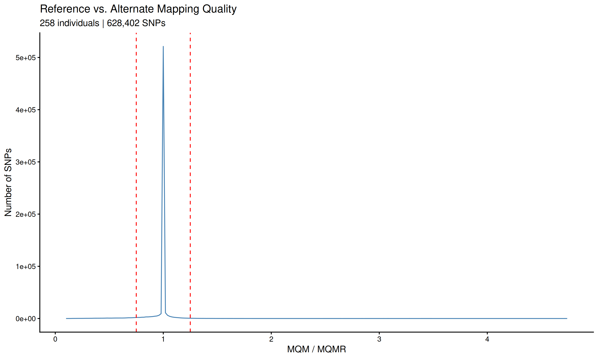

The dashed red lines indicate the acceptable mapping-quality ratio range of **0.75–1.25**. Ratios near 1 indicate similar mapping qualities for reads supporting reference and alternate alleles.

This figure illustrates the ratio criterion; the full filter additionally requires both MQM and MQMR to exceed 30.

### 17.3. Evaluate and apply the mapping-quality filter

The following criteria were selected:

- `MQM > 30`
- `MQMR > 30`
- `MQM/MQMR > 0.75`
- `MQM/MQMR < 1.25`

The filter was applied using:

```bash
bcftools view \
  -i 'INFO/MQM>30 && INFO/MQMR>30 && INFO/MQM/INFO/MQMR>0.75 && INFO/MQM/INFO/MQMR<1.25' \
  -Oz \
  -o 17_mapping_quality_filtered.vcf.gz \
  16_allele_balance_filtered.vcf.gz

bcftools index -t 17_mapping_quality_filtered.vcf.gz
```

**Filtering results:**

| Metric | SNP count |
|---|---:|
| SNPs before mapping-quality filtering | 628,402 |
| SNPs removed | 32,596 |
| SNPs retained | **595,806** |
| Percentage removed | 5.19% |
| Percentage retained | 94.81% |
| Individuals retained | **258** |

The resulting VCF was validated using:

```bash
bgzip -t 17_mapping_quality_filtered.vcf.gz

bcftools index -n 17_mapping_quality_filtered.vcf.gz

bcftools query -l 17_mapping_quality_filtered.vcf.gz | wc -l
```

All integrity checks passed, confirming that the compressed VCF was readable, its index was consistent, and all 258 individuals were retained.

A recurring VCF-header warning indicated that the `GQ` field should be declared as `Type=Integer`. This warning originated from the input VCF header and did not prevent successful filtering or validation.

**Filtering decision:** Apply the MQM/MQMR filter after allele-balance filtering.

**Final output:** `17_mapping_quality_filtered.vcf.gz`

**Final SNP count:** 595,806

**Final individual count:** 258

---

### Summary of filtering stages 15–17

| Stage | Filtering operation | SNPs retained |
|---|---|---:|
| 15 | Retain single-base REF and ALT alleles | 839,809 |
| 16 | Apply allele-balance filter | 628,402 |
| 17 | Apply mapping-quality filter | **595,806** |

The resulting dataset will be used for the next quality-control step: evaluation of observed heterozygosity relative to minor allele frequency.

Because the previous heterozygosity analysis was performed before AB filtering, its statistics and figures must be recalculated using the new 595,806-SNP dataset.

The next quality-control step evaluated SNPs exhibiting unexpectedly high observed heterozygosity relative to minor allele frequency (MAF). This analysis was recommended in the ezRAD filtering workflow as a way to identify potentially problematic SNPs when conventional Hardy–Weinberg equilibrium (HWE) filtering is not applied.

Conventional HWE filtering was not used because *Pocillopora acuta* exhibits both sexual and asexual reproduction, and some individuals may be triploid. Furthermore, individuals were sampled across multiple locations rather than from a single randomly mating population.

Instead, observed heterozygosity was compared with MAF to investigate potential excess heterozygosity and assess whether an additional SNP filter was justified.

### 1. Calculate MAF and observed heterozygosity

Allele frequencies were calculated using VCFtools:

```bash
vcftools \
  --gzvcf 17_mapping_quality_filtered.vcf.gz \
  --freq \
  --out 18_heterozygosity_maf
```

Observed and expected genotype counts were calculated using:

```bash
vcftools \
  --gzvcf 17_mapping_quality_filtered.vcf.gz \
  --hardy \
  --out 18_heterozygosity_hwe
```

The `--hardy` command was used only to calculate genotype statistics. **No HWE significance-based filtering was performed.**

Both commands processed all 779,740 SNPs and 258 individuals.

### 2. Calculate observed heterozygosity in R

```r
library(ggplot2)
library(dplyr)

freq <- read.table(
  "18_heterozygosity_maf.frq",
  header = FALSE,
  skip = 1,
  col.names = c(
    "CHROM", "POS", "N_ALLELES",
    "N_CHR", "FREQ1", "FREQ2"
  )
)

freq$FREQ1 <- as.numeric(sub(".*:", "", freq$FREQ1))
freq$FREQ2 <- as.numeric(sub(".*:", "", freq$FREQ2))

freq$MAF <- pmin(freq$FREQ1, freq$FREQ2)

het <- read.table(
  "18_heterozygosity_hwe.hwe",
  header = TRUE,
  check.names = FALSE
)

obs <- strsplit(
  het[["OBS(HOM1/HET/HOM2)"]],
  "/"
)

obs <- do.call(rbind, obs)
storage.mode(obs) <- "numeric"

het$N_HOM1 <- obs[, 1]
het$N_HET <- obs[, 2]
het$N_HOM2 <- obs[, 3]

het$N_CALLED <- het$N_HOM1 + het$N_HET + het$N_HOM2

het$FHET_OBS <- het$N_HET / het$N_CALLED

het_maf <- merge(
  freq[, c("CHROM", "POS", "MAF")],
  het[, c("CHR", "POS", "FHET_OBS")],
  by.x = c("CHROM", "POS"),
  by.y = c("CHR", "POS")
)
```

The resulting dataset contained **779,740 SNPs**, with no missing MAF or observed heterozygosity values. All MAF values were between 0.01 and 0.50.

**Table. Summary statistics for MAF and observed heterozygosity.**

| Statistic | MAF | Observed heterozygosity |
|---|---:|---:|
| Minimum | 0.0100 | 0.0000 |
| First quartile | 0.0228 | 0.0338 |
| Median | 0.0774 | 0.1321 |
| Mean | 0.1291 | 0.2083 |
| Third quartile | 0.2053 | 0.3550 |
| Maximum | 0.5000 | 0.9961 |

### 3. Visualize observed heterozygosity against MAF

Observed heterozygosity was plotted against MAF to investigate whether SNPs formed distinct groups with unusually high heterozygosity.

For diploid, biallelic loci, expected heterozygosity under HWE is:

\[
H_E = 2p(1-p)
\]

where \(p\) is MAF.

The maximum possible observed heterozygosity is:

\[
H_{O,\max} = 2p
\]

for \(0 \leq p \leq 0.5\).

The fin plot included both theoretical curves and horizontal reference lines representing candidate observed heterozygosity thresholds.

```r
ggplot(het_maf, aes(x = MAF, y = FHET_OBS)) +
  geom_point(
    alpha = 0.08,
    size = 0.25,
    color = "steelblue"
  ) +
  stat_function(
    fun = function(x) 2 * x * (1 - x),
    color = "red",
    linewidth = 0.8
  ) +
  stat_function(
    fun = function(x) 2 * x,
    color = "darkorange",
    linetype = "dashed",
    linewidth = 0.8
  ) +
  geom_hline(
    yintercept = c(0.40, 0.50, 0.60, 0.70),
    color = c("purple", "darkgreen", "brown", "black"),
    linetype = "dashed",
    linewidth = 0.8
  ) +
  annotate(
    "label",
    x = 0.08,
    y = c(0.40, 0.50, 0.60, 0.70),
    label = c(
      "FHET = 0.40",
      "FHET = 0.50",
      "FHET = 0.60",
      "FHET = 0.70"
    ),
    color = c("purple", "darkgreen", "brown", "black"),
    fill = "white",
    size = 3.5,
    hjust = 0
  ) +
  coord_cartesian(
    xlim = c(0, 0.5),
    ylim = c(0, 1)
  ) +
  labs(
    title = "Observed Heterozygosity vs. Minor Allele Frequency",
    subtitle = "258 individuals | 779,740 SNPs",
    x = "Minor allele frequency (MAF)",
    y = "Observed heterozygote frequency"
  ) +
  theme_classic()

ggsave(
  "18_maf_vs_heterozygosity_cutoff_comparison.png",
  width = 10,
  height = 7,
  dpi = 300
)
```

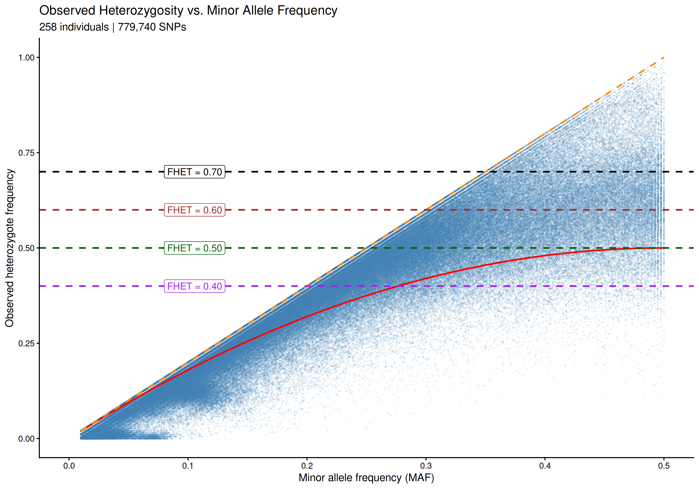

The fin plot showed a continuous distribution of SNPs bounded by the theoretical maximum observed heterozygosity. Many SNPs exhibited heterozygosity above the HWE expectation, although no clearly separated group of extreme SNPs was apparent.

A reduction in SNP density was visually apparent toward higher heterozygosity values, motivating comparison of several candidate thresholds rather than automatically applying the example cutoff of 0.40 from the ezRAD workflow.

### 4. Evaluate heterozygosity excess relative to HWE expectations

Heterozygosity excess was calculated as the difference between observed and expected heterozygosity:

\[
H_{\text{excess}} = H_O - H_E
\]

```r
het_maf$FHET_EXP <- 2 * het_maf$MAF * (1 - het_maf$MAF)

het_maf$HET_EXCESS <- (
  het_maf$FHET_OBS - het_maf$FHET_EXP
)

summary(het_maf$HET_EXCESS)
```

**Table. Summary statistics for heterozygosity excess.**

| Statistic | Heterozygosity excess |
|---|---:|
| Minimum | -0.426170 |
| First quartile | -0.018504 |
| Median | 0.001087 |
| Mean | 0.016339 |
| Third quartile | 0.029882 |
| Maximum | 0.496117 |

The median heterozygosity excess was close to zero, indicating that the typical SNP had observed heterozygosity close to the pooled HWE expectation. The slightly positive mean indicated an overall tendency toward heterozygote excess.

The number of SNPs exceeding different levels of heterozygosity excess was then calculated:

```r
thresholds <- c(0, 0.05, 0.10, 0.15, 0.20, 0.25)

data.frame(
  Excess_Threshold = thresholds,
  SNPs_Above = sapply(
    thresholds,
    function(x) sum(het_maf$HET_EXCESS > x)
  ),
  Percent_Above = round(
    sapply(
      thresholds,
      function(x) mean(het_maf$HET_EXCESS > x) * 100
    ),
    2
  )
)
```

**Table. SNPs exceeding different heterozygosity-excess thresholds.**

| Excess threshold | SNPs above threshold | Percentage |
|---|---:|---:|
| > 0.00 | 457,292 | 58.65% |
| > 0.05 | 150,491 | 19.30% |
| > 0.10 | 78,295 | 10.04% |
| > 0.15 | 38,335 | 4.92% |
| > 0.20 | 18,693 | 2.40% |
| > 0.25 | 8,937 | 1.15% |

Although 58.65% of SNPs exhibited positive heterozygosity excess, only 1.15% exceeded the HWE expectation by more than 0.25.

The gradual decline in SNP counts across these thresholds did not indicate a clear natural breakpoint.

### 5. Compare candidate observed heterozygosity cutoffs

Several absolute observed heterozygosity cutoffs were evaluated to quantify their effects on SNP retention.

```r
cutoffs <- c(0.60, 0.65, 0.70, 0.75, 0.80)

het_comparison <- data.frame(
  FHET_Cutoff = cutoffs,
  SNPs_Removed = sapply(
    cutoffs,
    function(x) sum(het_maf$FHET_OBS > x)
  ),
  SNPs_Retained = sapply(
    cutoffs,
    function(x) sum(het_maf$FHET_OBS <= x)
  ),
  Percent_Removed = round(
    sapply(
      cutoffs,
      function(x) mean(het_maf$FHET_OBS > x) * 100
    ),
    2
  )
)

print(het_comparison)
```


**Table. Expected SNP retention under alternative observed heterozygosity thresholds.**

| FHET cutoff | SNPs removed | SNPs retained | Percentage removed |
|---|---:|---:|---:|
| 0.60 | 41,358 | 738,382 | 5.30% |
| 0.65 | 24,828 | 754,912 | 3.18% |
| 0.70 | 13,645 | 766,095 | 1.75% |
| 0.75 | 7,156 | 772,584 | 0.92% |
| 0.80 | 3,762 | 775,978 | 0.48% |

An FHET cutoff of 0.70 would remove 13,645 SNPs (1.75%), whereas a cutoff of 0.60 would remove 41,358 SNPs (5.30%).

Absolute heterozygosity thresholds were interpreted cautiously because the maximum possible observed heterozygosity depends on MAF. For example, an FHET cutoff of 0.70 can only exclude diploid biallelic SNPs with MAF above approximately 0.35.

### 6. Investigate the relationship between heterozygosity and sequencing depth

High observed heterozygosity can sometimes result from reads originating from duplicated genomic regions that align to the same reference position.

Such loci may also exhibit elevated sequencing depth. Therefore, mean depth was compared between SNPs exhibiting extreme heterozygosity excess and the remaining SNPs.

Site mean depth was calculated using:

```bash
vcftools \
  --gzvcf 17_mapping_quality_filtered.vcf.gz \
  --site-mean-depth \
  --out 18_heterozygosity_depth
```

Depth values were matched to the heterozygosity dataset by chromosome and position.

```r
depth <- read.table(
  "18_heterozygosity_depth.ldepth.mean",
  header = TRUE
)

het_depth <- merge(
  het_maf,
  depth[, c("CHROM", "POS", "MEAN_DEPTH")],
  by = c("CHROM", "POS")
)

het_depth$HET_GROUP <- ifelse(
  het_depth$HET_EXCESS > 0.25,
  "Extreme excess (>0.25)",
  "Other SNPs"
)

aggregate(
  MEAN_DEPTH ~ HET_GROUP,
  data = het_depth,
  FUN = median
)
```

All 779,740 SNPs were successfully matched.

**Table. Median mean sequencing depth by heterozygosity-excess category.**

| SNP category | Median mean depth |
|---|---:|
| Extreme heterozygosity excess (>0.25) | 13.8415 |
| Other SNPs | 9.8996 |

SNPs exhibiting extreme heterozygosity excess had approximately 40% higher median mean depth than other SNPs.

Depth was also compared specifically for SNPs above and below an observed heterozygosity threshold of 0.70.

```r
het_depth$FHET_GROUP <- ifelse(
  het_depth$FHET_OBS > 0.70,
  "Above 0.70",
  "At or below 0.70"
)

aggregate(
  MEAN_DEPTH ~ FHET_GROUP,
  data = het_depth,
  FUN = median
)
```

**Table. Median mean sequencing depth above and below FHET = 0.70.**

| SNP category | Median mean depth |
|---|---:|
| FHET > 0.70 | 12.2913 |
| FHET ≤ 0.70 | 9.8943 |

SNPs above the proposed FHET threshold of 0.70 had approximately 24% higher median sequencing depth than those below it.

These results are consistent with the possibility that some high-heterozygosity SNPs originate from duplicated or ambiguously mapped regions. However, elevated depth is not sufficient to establish that these SNPs are erroneous.

### 7. Interpretation and filtering decision

The heterozygosity analysis identified a broad, continuous distribution of SNPs, including a subset exhibiting substantial heterozygote excess.

Several considerations affect interpretation:

- *Pocillopora acuta* reproduces sexually and asexually, and clonality may influence genotype frequencies.
- Some individuals may be triploid, complicating interpretation of diploid genotype calls.
- The dataset contains individuals sampled across multiple geographic locations rather than a single randomly mating population.
- Excess heterozygosity and elevated depth may indicate duplicated genomic regions or mapping artifacts, but are not definitive evidence of technical error.
- Absolute FHET cutoffs preferentially exclude common SNPs because the maximum possible heterozygosity increases with MAF.

The comparison of candidate cutoffs showed that moderate-to-high FHET thresholds could exclude a relatively small subset of SNPs. However, the fin plot and heterozygosity-excess distribution did not establish a unique, biologically justified threshold.

**Filtering decision: Pending.**

No heterozygosity-based SNP filter has yet been applied. The diagnostic results will be used to select an appropriate threshold, if warranted, before proceeding to subsequent quality-control steps.

**Current working VCF:** `17_mapping_quality_filtered.vcf.gz`

**Current SNP count:** 779,740

**Current individual count:** 258

## Summary of Filtering Decisions

| Filtering criterion | Threshold | Status |
|---|---|---|
| Individual missingness | Remove individuals with ≥90% missing genotypes | Applied |
| Site completeness | ≥70% genotyped individuals | Applied |
| Minor allele count | MAC ≥2, reassessed after individual removal | Applied |
| Minimum mean site depth | None beyond existing per-genotype DP ≥3 | Omitted |
| Maximum mean site depth | ≤500× | Selected, not yet applied |
| Global MAF | ≥0.01 | Selected; application to be confirmed |
| Local/population-specific MAF | Not applicable to individual-based sampling | Omitted |
| HWE | No HWE filtering | Omitted |
| Allele length, allele balance, mapping quality, paired-read metrics, QUAL/DP | To be evaluated | Pending |

**Current confirmed dataset:** `10_site70_mac2.vcf.gz` — 258 individuals and 1,332,396 SNPs.

**Next filtering stages:** Apply global MAF ≥0.01, confirm SNP retention, evaluate maximum mean depth of 500×, and assess additional site-quality filters.

### Table 6. Output files generated

| **Analysis** | **Output file** | **Purpose** |
|----|----|----|
| Initial BCFtools filtering | `01_biallelic_snps.vcf.gz` | Biallelic SNP dataset after initial filtering |
| Initial VCFtools filtering | `02_initial_vcftools.vcf.gz` | Dataset after quality, minor allele count and genotype depth filters |
| Individual missingness | `03_individual_missingness.imiss` | Missing genotype proportion for each sample |
| Site missingness | `04_site_missingness.lmiss` | Missing genotype proportion for each SNP |
| Mean SNP depth | `04_site_mean_depth.ldepth.mean` | Mean sequencing depth for each SNP |

## 9. Additional Mean-Depth Assessment

### 9.1 Purpose

The initial mean-depth assessment showed that SNPs with at least 70%
sample completeness generally had higher mean sequencing depth than the
full SNP dataset.

We therefore examined the upper tail of the mean-depth distribution to
determine whether unusually high-depth SNPs should be excluded.

Very high sequencing depth can sometimes indicate repetitive genomic
regions, duplicated sequences, or reads from multiple genomic locations
mapping to the same reference position. However, high depth alone does
not establish that a SNP is erroneous.

### Table 7. Upper-depth tail among SNPs with ≥70% completeness

| Mean SNP depth | Number of SNPs above threshold |
|----------------|-------------------------------:|
| \>50×          |                         11,109 |
| \>75×          |                          4,091 |
| \>100×         |                          1,884 |
| \>150×         |                            541 |
| \>200×         |                            167 |

**Interpretation:** Only 1,884 of the 1,256,391 SNPs meeting the
provisional 70% completeness threshold had mean depth greater than 100×,
representing approximately 0.15% of these SNPs.

**Provisional filtering decision:** Consider applying a maximum
mean-depth threshold of 100×.

**Reasoning:**

- Unusually high-depth SNPs may represent duplicated or repetitive
  genomic regions.
- The proposed threshold would remove only a small proportion of SNPs
  meeting the completeness requirement.
- A maximum-depth filter may reduce potentially problematic loci without
  substantially reducing the available SNP dataset.
- The 100× threshold is a pragmatic quality-control choice rather than a
  demonstrated biological boundary.

No additional minimum mean-depth threshold is proposed because the ≥70%
completeness subset already has substantially improved mean depth.

**Status:** Diagnostic complete. Maximum mean-depth filter not yet
applied.

## 10. FreeBayes Mapping-Quality Assessment

### 10.1 Purpose

Mapping quality indicates how confidently sequencing reads align to the
reference genome.

Two FreeBayes INFO annotations were examined:

- `MQM`: Mean mapping quality of reads supporting the alternate allele.
- `MQMR`: Mean mapping quality of reads supporting the reference allele.

Examining both metrics is important because reads supporting the
reference and alternate alleles may differ in mapping confidence.

### 10.2 Mapping quality across all initially filtered SNPs

The distribution of `MQM` was examined across all 8,933,146 SNPs in
`02_initial_vcftools.vcf.gz`.

### Table 8. Alternate-allele mapping quality across all SNPs

| MQM range | Number of SNPs | Percentage |
|-----------|---------------:|-----------:|
| \<20      |         96,582 |       1.1% |
| 20–30     |        298,545 |       3.3% |
| 30–40     |        482,484 |       5.4% |
| 40–50     |        896,227 |      10.0% |
| ≥50       |      7,159,308 |      80.1% |
| **Total** |  **8,933,146** |   **100%** |

**Interpretation:** Most SNPs had relatively high alternate-allele
mapping quality. Approximately 80.1% had `MQM ≥50`.

### 10.3 Mapping quality among SNPs with ≥70% completeness

We repeated the assessment for SNPs genotyped in at least 70% of the 263
individuals.

### Table 9. Alternate-allele mapping quality among higher-completeness SNPs

| MQM range | Number of SNPs |
|-----------|---------------:|
| \<20      |         10,308 |
| 20–30     |         36,603 |
| 30–40     |         39,913 |
| 40–50     |         96,047 |
| ≥50       |      1,073,520 |
| **Total** |  **1,256,391** |

Approximately 85.4% of these SNPs had `MQM ≥50`.

#### Figure 1. Alternate-allele mapping quality among SNPs with ≥70% completeness

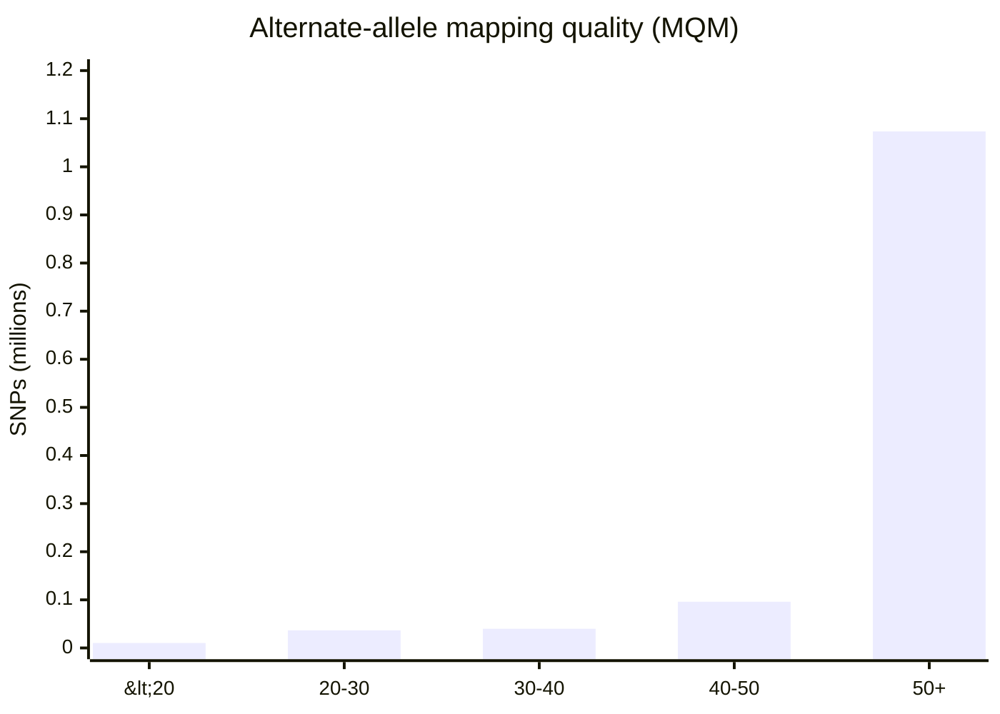

**Figure interpretation:** Most SNPs meeting the completeness threshold
have high alternate-allele mapping quality. The higher-completeness
subset also has a larger proportion of high-MQM SNPs than the full
dataset.

### 10.4 Comparing reference and alternate mapping quality

We examined both `MQM` and `MQMR` among the 1,256,391 SNPs meeting the
provisional completeness threshold.

### Table 10. SNP retention under alternative mapping-quality thresholds

| Required mapping quality for both alleles | SNPs failing | SNPs passing |
|-------------------------------------------|-------------:|-------------:|
| ≥30                                       |       50,686 |    1,205,705 |
| ≥40                                       |       99,534 |    1,156,857 |
| ≥50                                       |      204,940 |    1,051,451 |

Additional diagnostic result:

**66,579 SNPs** had alternate-allele mapping quality more than 10 points
below reference-allele mapping quality.

This represents approximately 5.3% of SNPs meeting the completeness
threshold.

Such differences can indicate allele-specific mapping uncertainty,
although they do not automatically establish that a variant is
incorrect.

### 10.5 Mapping-quality filtering decision

**Provisional decision:** Require both `MQM ≥40` and `MQMR ≥40`.

**Reasoning:**

1.  Both reference and alternate alleles should have reasonably
    confident mapping support.
2.  Requiring both values to be at least 40 would retain approximately
    92.1% of SNPs meeting the completeness threshold.
3.  A threshold of 50 would remove substantially more SNPs.
4.  The proposed threshold may reduce false-positive SNPs associated
    with ambiguous read alignments.
5.  It balances quality control with retaining enough markers for PCA
    and species identification.

**Status:** Diagnostic complete. Mapping-quality filter not yet applied.

## 11. Allele-Balance Assessment

### 11.1 Purpose

Allele balance describes the relative representation of reference and
alternate reads among heterozygous observations.

For a diploid heterozygous genotype, approximately balanced read support
is generally expected, although sequencing depth, sampling variation,
and alignment bias can cause deviations.

FreeBayes `AB` is a site-level annotation, rather than a direct measure
of allele balance for each individual genotype.

### 11.2 Allele-balance distribution

The `AB` distribution was examined across all 8,933,146 initially
filtered SNPs.

### Table 11. FreeBayes allele-balance distribution

| AB range  | Number of SNPs |
|-----------|---------------:|
| \<0.1     |      1,312,114 |
| 0.1–0.2   |        420,636 |
| 0.2–0.3   |        983,509 |
| 0.3–0.4   |      1,567,457 |
| 0.4–0.6   |      3,991,528 |
| 0.6–0.8   |        632,086 |
| \>0.8     |         25,816 |
| **Total** |  **8,933,146** |

Approximately 44.7% of SNPs had AB between 0.4 and 0.6.

However, 1,312,114 SNPs had AB below 0.1, prompting further
investigation before choosing an allele-balance threshold.

### 11.3 Investigating SNPs with very low allele balance

Five SNPs with `AB <0.1` were inspected directly.

All five had `AB = 0` and no heterozygous genotype calls in the current
VCF. Instead, they contained combinations of homozygous-reference
genotypes (`0/0`), occasional homozygous-alternate genotypes (`1/1`),
and missing genotypes (`./.`).

We then counted heterozygous genotype calls across all SNPs with
`AB <0.1`.

### Table 12. Heterozygous genotype counts among SNPs with AB \<0.1

| Heterozygous calls per SNP | Number of SNPs | Percentage |
|----------------------------|---------------:|-----------:|
| Zero                       |      1,302,260 |     99.25% |
| 1–2                        |          8,343 |      0.64% |
| More than 2                |          1,511 |      0.12% |
| **Total**                  |  **1,312,114** |   **100%** |


**Figure interpretation:** Approximately 99.25% of SNPs with very low AB
had no heterozygous genotype calls in the current filtered VCF.

This is important because a SNP without heterozygous calls cannot be
meaningfully evaluated for read balance within its currently observed
heterozygotes.

An additional consideration is that FreeBayes calculated the original
INFO annotations before VCFtools masked genotypes with depth below 3×.
Therefore, the current genotype calls and original site-level AB
annotations may not reflect exactly the same observations.

### 11.4 Allele-balance filtering decision

**Decision: Do not apply a blanket site-level AB filter at this stage.**

**Reasoning:**

1.  Nearly all SNPs with AB below 0.1 have no heterozygous calls in the
    current VCF.
2.  Low AB therefore does not necessarily indicate poorly balanced
    heterozygous genotypes.
3.  SNPs without heterozygotes may still contain useful genetic
    variation.
4.  Such SNPs may be informative for distinguishing *Pocillopora*
    species during PCA.
5.  Applying a strict AB threshold could remove potentially valid
    markers unnecessarily.
6.  If allele balance becomes a concern later, genotype-level
    allele-balance assessment would be more informative.

**Status:** Diagnostic complete. No blanket AB filter recommended.

## 12. Properly Paired Read Assessment

### 12.1 Purpose

FreeBayes provides two annotations describing properly paired read
support:

- `PAIRED`: Fraction of alternate-allele observations supported by
  properly paired reads.
- `PAIREDR`: Fraction of reference-allele observations supported by
  properly paired reads.

Low values can sometimes indicate problematic alignments, although
paired-read support also depends on library preparation and read
processing.

### 12.2 Results

Both metrics were examined among SNPs meeting the provisional 70%
sample-completeness threshold.

### Table 13. Properly paired read support

| Diagnostic                            | Number of SNPs |
|---------------------------------------|---------------:|
| SNPs with ≥70% completeness           |      1,256,391 |
| Missing either paired-read annotation |              0 |
| Either allele paired fraction \<0.5   |              0 |
| Either allele paired fraction \<0.8   |              0 |
| Either allele paired fraction \<0.9   |              0 |
| Both paired fractions ≥0.9            |      1,256,391 |

All candidate SNPs had both `PAIRED ≥0.9` and `PAIREDR ≥0.9`.

**Interpretation:** Properly paired read support was consistently high
among the candidate SNPs.

Although this is reassuring, properly paired reads are not necessarily
uniquely or correctly mapped reads. Mapping quality remains an important
complementary measure.

### 12.3 Paired-read filtering decision

**Decision: Do not add a paired-read filter at this stage.**

**Reasoning:**

- All SNPs meeting the completeness threshold already have strong
  paired-read support.
- A threshold of 0.9 would remove no SNPs from the candidate dataset.
- Adding a filter that removes no SNPs would not improve the dataset.

**Status:** Diagnostic complete. No additional paired-read filter
recommended.

## 13. Combined Candidate-Filter Assessment

### 13.1 Purpose

Before creating another filtered VCF, we calculated the combined effects
of the proposed SNP-completeness, maximum-depth, and mapping-quality
thresholds.

This is important because SNPs may fail more than one quality criterion.
Adding removal counts from separate diagnostics could therefore
overestimate the total number of SNPs excluded.

The proposed criteria are:

1.  SNP completeness ≥70%.
2.  Mean SNP depth ≤100×.
3.  Alternate-allele mapping quality (`MQM`) ≥40.
4.  Reference-allele mapping quality (`MQMR`) ≥40.

### Table 14. Combined projected SNP retention

| Filtering stage                | SNPs remaining | SNPs removed at this stage |
|--------------------------------|---------------:|---------------------------:|
| Current initially filtered VCF |      8,933,146 |                          — |
| SNP completeness ≥70%          |      1,256,391 |                  7,676,755 |
| Plus mean SNP depth ≤100×      |      1,254,507 |                      1,884 |
| Plus MQM ≥40 and MQMR ≥40      |  **1,155,557** |                 **98,950** |

The depth and mapping-quality criteria together would exclude 100,834
SNPs after the completeness threshold.

Approximately 92.0% of SNPs meeting the 70% completeness threshold would
survive the additional proposed filters.

### 13.2 Visualizing the combined filtering results

#### Figure 3. SNP filtering workflow

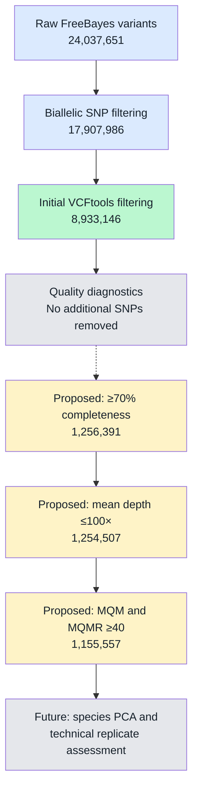

**Figure interpretation:** The first two filtering stages are complete.
The later thresholds have been evaluated using diagnostics but have not
yet been applied to generate a new VCF.

#### Figure 4. Projected SNP retention

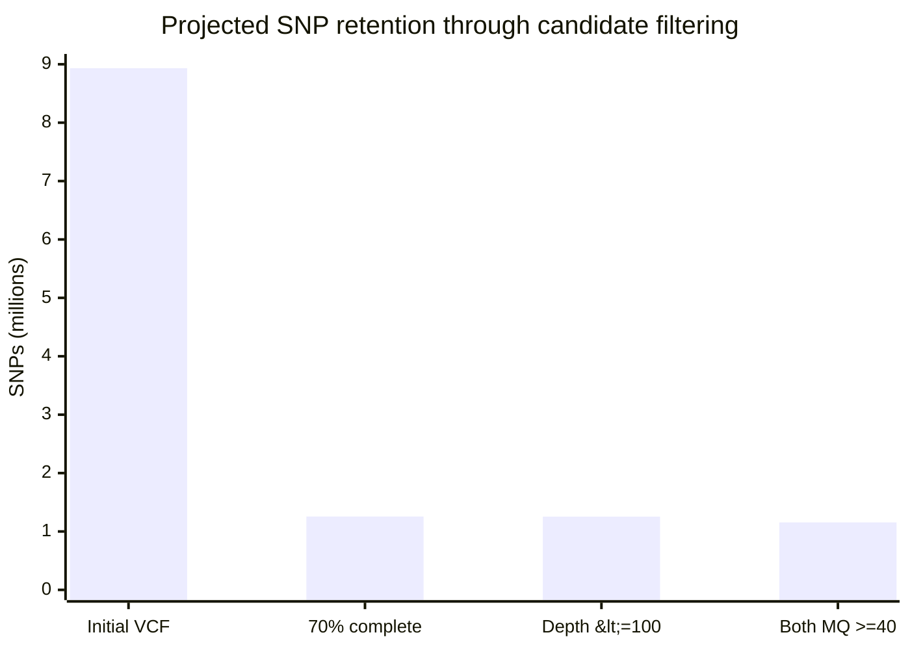

**Figure interpretation:** The 70% completeness threshold has the
largest effect on SNP retention. The proposed maximum-depth and
mapping-quality thresholds remove comparatively few additional SNPs.

#### Figure 5. Effect of depth and mapping-quality filtering after the completeness threshold

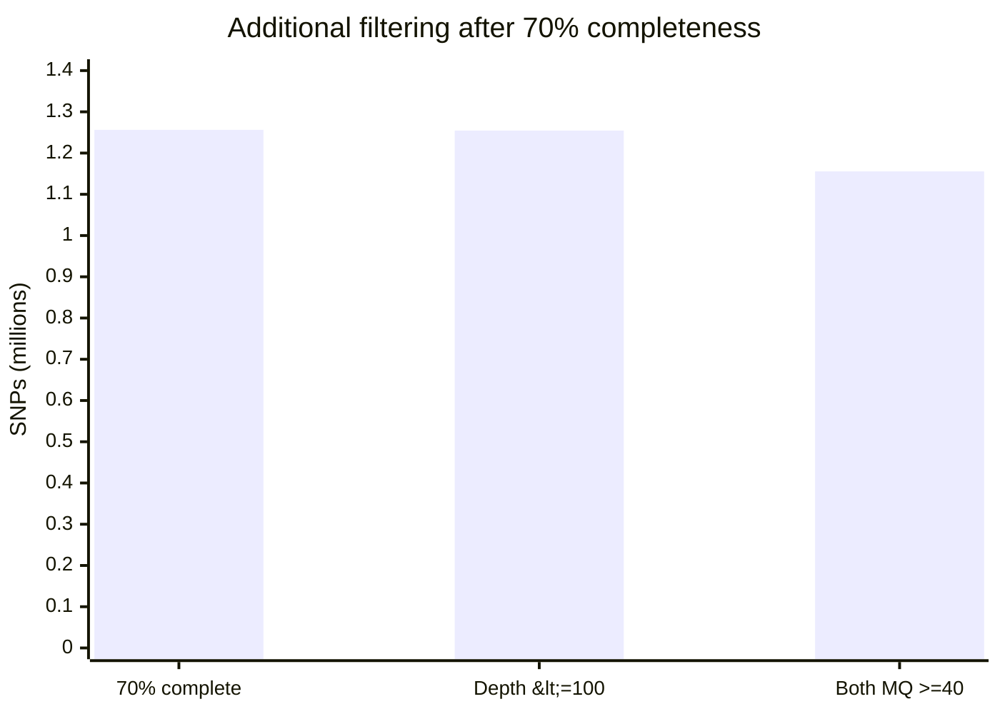

**Figure interpretation:** After restricting SNPs to those present in at
least 70% of samples, the maximum-depth threshold removes only 1,884
SNPs. The mapping-quality criteria then remove another 98,950 SNPs.

### 13.3 Candidate filtering decision

**Provisional decision:** Generate a candidate filtered VCF using the
following thresholds:

| Criterion                        | Proposed threshold   |
|----------------------------------|----------------------|
| SNP completeness                 | ≥70%                 |
| Mean SNP depth                   | ≤100×                |
| Alternate-allele mapping quality | MQM ≥40              |
| Reference-allele mapping quality | MQMR ≥40             |
| Additional minimum mean depth    | None                 |
| Site-level allele balance        | No blanket filter    |
| Properly paired read support     | No additional filter |

**Reasoning:**

- The completeness threshold improves the overall depth profile while
  retaining more than 1.25 million SNPs.
- The maximum-depth filter removes a small number of unusually
  high-depth loci.
- The mapping-quality filters require reasonably confident read mapping
  for both alleles.
- The allele-balance diagnostic does not justify a blanket AB filter.
- The paired-read metrics already show strong support among all
  candidate SNPs.
- Approximately 1.16 million SNPs are projected to remain, providing a
  substantial candidate dataset for further evaluation.

**Important:** The projected SNP count is based on diagnostic
calculations. The candidate filtered VCF has not yet been generated, and
its actual SNP count must be verified.

## 14. Additional Visual Summaries

The following figures summarize earlier results from Sections 1–8. They
are included here so that the original tables and descriptions can
remain unchanged.

### Figure 6. Individual missingness across all 263 samples

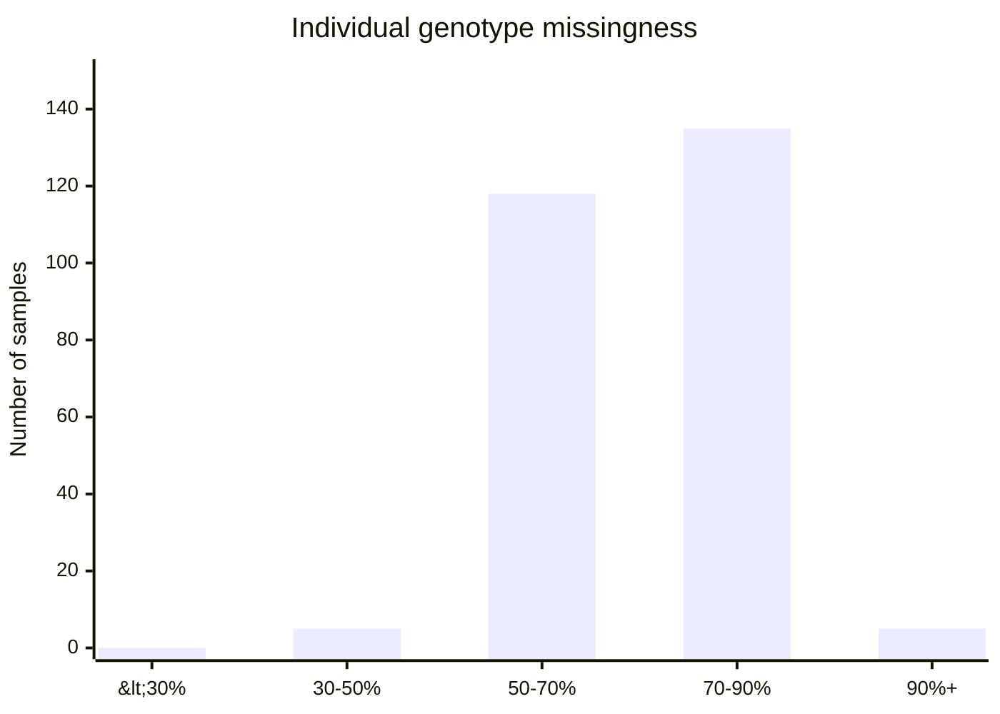

**Interpretation:** Most samples have high missingness in the current
VCF. Nevertheless, all 263 samples are being retained until
species-identification PCA and technical-replicate comparisons are
completed.

### Figure 7. SNP retention by minimum sample completeness

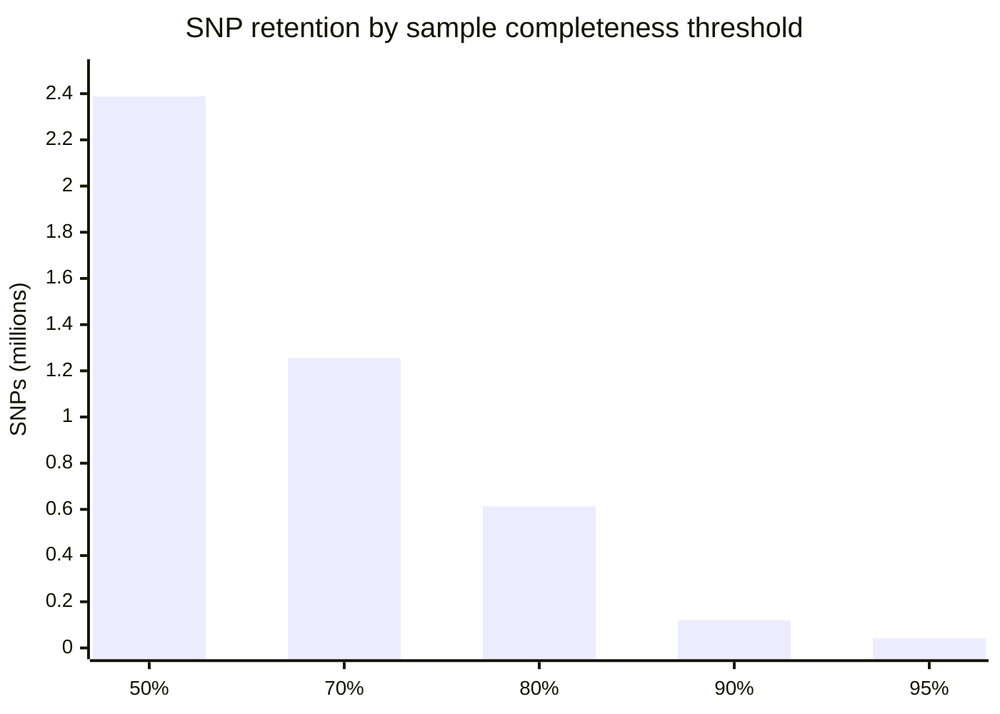

**Interpretation:** Increasing the minimum sample-completeness
requirement substantially reduces the number of retained SNPs.

The provisional 70% threshold represents a compromise between retaining
genetic markers and reducing missing data.

A stricter completeness threshold may be evaluated later as a
sensitivity analysis for PCA.

## 15. Updated SNP Filtering Decision Summary

| Filtering criterion | Status | Reason |
|----|----|----|
| Biallelic SNPs | Applied | Exclude indels and multiallelic variants |
| Minimum variant quality ≥20 | Applied | Remove lower-quality variant calls |
| Minimum minor allele count ≥2 | Applied initially | Exclude variants with very low observed minor allele counts |
| Minimum genotype depth ≥3× | Applied | Mask low-depth genotypes |
| Individual missingness | Diagnostic only | Retain all individuals for species PCA and replicate comparisons |
| SNP completeness ≥70% | Provisional | Balance SNP retention with reduced missingness |
| Additional minimum mean depth | Not recommended | Higher-completeness SNPs already show improved depth |
| Maximum mean depth ≤100× | Provisional | Remove a small number of unusually high-depth loci |
| MQM ≥40 and MQMR ≥40 | Provisional | Require good mapping quality for both alleles |
| Site-level allele balance | No blanket filter | Low AB is strongly associated with zero heterozygous calls |
| PAIRED and PAIREDR | No additional filter | All candidate SNPs have paired-read fractions ≥0.9 |
| Global MAF | Pending | Compare suitable thresholds before final downstream analyses |
| Heterozygosity filtering | Pending | Evaluate problematic loci without prematurely excluding species-informative SNPs |
| SNP thinning / linkage | Pending | Reduce non-independence where appropriate for PCA |
| Sample removal | Not permitted at this stage | Complete species identification and technical replicate assessment first |

## 16. Reproducibility Notes

The following points are important for interpreting and reproducing
these analyses:

- All diagnostics were performed using `02_initial_vcftools.vcf.gz`,
  unless otherwise stated.
- This VCF contains 8,933,146 SNPs and 263 individuals.
- The original `TotalRawSNPs.vcf` remains preserved.
- The candidate completeness, maximum-depth, and mapping-quality filters
  have not yet been applied.
- The site-missingness file `04_site_missingness.lmiss` contains six
  columns; `F_MISS` is column 6.
- The site-mean-depth file `04_site_mean_depth.ldepth.mean` contains
  four columns; `MEAN_DEPTH` is column 3.
- Combined diagnostics used chromosome and position checks to verify
  that corresponding rows from different files referred to the same SNP.
- FreeBayes INFO annotations were generated during variant calling and
  may not fully reflect subsequent genotype masking by VCFtools.
- All 263 coral samples remain retained.
- No population-level MAF filters will be applied using individual
  sampling sites as populations because sampling sites contain only 1–3
  individuals.
- Global MAF thresholds of 0.01 and 0.05 remain under consideration.
- The projected SNP counts are diagnostic estimates, not verified counts
  from a newly generated VCF.
- All Mermaid figures contain their numerical data directly in the
  Markdown code and do not require separate image files.

**Current status:** Initial SNP filtering and additional quality
diagnostics are complete. The next candidate filtering step has been
evaluated but not yet executed. All 263 individuals remain retained.

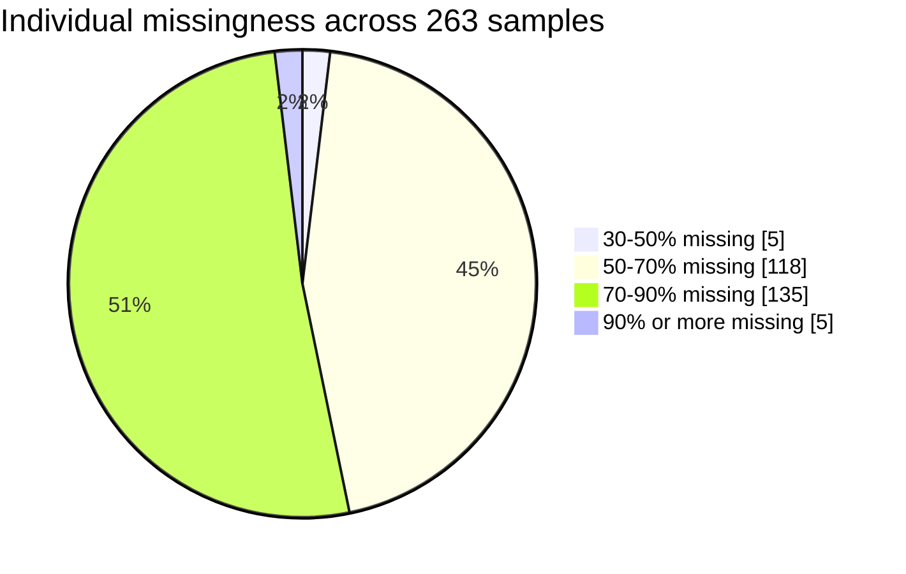

## SNP Filtering Summary and Decision Log

### Overview

The initial dDocent variant-calling workflow produced **24,037,651 variant records across 263 samples**. SNP filtering was designed to retain reliable, informative variants for species identification, technical replicate comparisons, and subsequent seascape genomic analyses.

Because the dataset contains only 1–3 samples per sampling site, filtering decisions were based primarily on variant quality, sequencing depth, genotype completeness, and mapping reliability rather than population-specific allele frequencies or Hardy–Weinberg equilibrium.

**All 263 samples were retained throughout the filtering steps completed to date.** Sample selection will occur after SNP filtering, species identification using PCA, and technical replicate evaluation.

### Summary of filtering steps and results

| Step | Filter or analysis | SNPs retained | Reason for filter or analysis | Result and decision |
|---|---|---:|---|---|
| 0 | Original dDocent VCF (`TotalRawSNPs.vcf`) | 24,037,651 | Establish the starting dataset containing all called variants | 263 samples; baseline for filtering |
| 1 | Biallelic SNPs; exclude non-reference-only sites; mean site DP ≤2,000 | 17,907,986 | Retain simple SNPs and remove extreme-depth sites potentially associated with repetitive or problematic regions | 74.5% of original variants retained |
| 2 | QUAL ≥20; minor allele count ≥2; genotype DP ≥3 | 8,933,146 | Remove low-quality and singleton variants while masking individual genotype calls supported by fewer than three reads | 49.9% of Step 1 SNPs retained; 263 samples maintained |
| 3 | Individual missingness diagnostic | 8,933,146 | Assess variation in sequencing completeness among individuals before deciding on sample selection | 253 of 263 samples had ≥50% missing genotypes; no samples removed |
| 4 | Site missingness diagnostic; candidate ≥70% genotype presence | 1,256,391 projected | Identify loci with adequate genotype representation across samples for PCA and replicate comparisons | 14.1% of Step 2 SNPs meet the proposed threshold; filter not yet applied |
| 5 | Mean site depth diagnostic; candidate mean DP ≤100 | 1,254,507 projected | Exclude unusually high-depth sites that may represent repetitive regions, paralogs, or mapping artifacts | Removes 1,884 sites from the ≥70% presence subset; filter not yet applied |
| 6 | Mapping-quality diagnostic; candidate MQM ≥40 and MQMR ≥40 | 1,155,557 projected | Require reliable mapping of reads supporting both alternate and reference alleles | Combined with ≥70% presence and mean DP ≤100, retains approximately 1.16 million SNPs; filters not yet applied |
| 7 | Allele-balance diagnostic | No additional filtering | Evaluate whether allele balance could help identify unreliable SNPs | Most very low AB values occur at sites without heterozygotes; no blanket AB filter recommended |
| 8 | Paired-read diagnostic | No additional filtering | Evaluate whether poorly paired reads require additional filtering | All sites in the ≥70% presence subset had PAIRED and PAIREDR ≥0.9; no additional filter needed |

*Important: Steps 4–8 are diagnostic evaluations and proposed filtering decisions, not additional filtering commands already executed. The projected counts should not be described as final VCF results.*

### Key filtering decisions

**Biallelic SNPs:** Retaining biallelic variants simplifies downstream PCA and genotype-based analyses. Extreme mean depth was initially limited to 2,000 to exclude exceptionally high-coverage sites without prematurely applying a restrictive depth threshold.

**Variant quality and genotype depth:** A minimum site QUAL of 20 was selected as an initial quality threshold. A minor allele count of two removes singleton variants, while minimum genotype depth of three reduces reliance on very weak genotype calls. Low-depth genotypes are masked rather than removing entire samples.

**Site completeness:** A candidate threshold of 70% genotype presence was selected as a balance between SNP retention and missing data. The diagnostic results showed that approximately 1.26 million SNPs meet this threshold, providing a substantial marker set for further evaluation.

**Mean depth:** Sites with unusually high mean depth may reflect repetitive or duplicated genomic regions. A candidate upper threshold of 100 was supported by the observed depth distribution, where only 1,884 sites meeting the completeness threshold exceeded this value.

**Mapping quality:** Requiring both MQM and MQMR to be at least 40 provides a way to evaluate mapping reliability for both alleles. The combined diagnostic retained 1,155,557 candidate SNPs after the proposed completeness, depth, and mapping-quality requirements.

**Allele balance:** A blanket site-level AB filter was not selected because very low AB values were overwhelmingly associated with sites lacking heterozygotes. Applying such a filter could unnecessarily eliminate legitimate variants.

**Paired-read support:** Additional paired-read filtering was not selected because every site in the ≥70% presence subset already met the evaluated paired-read threshold.

**Sample retention:** All 263 samples remain in the dataset. Samples will not be removed until species identification and technical replicate comparisons have been completed.

### Overall retention

| Comparison | SNPs | Percentage |
|---|---:|---:|
| Original variant records | 24,037,651 | 100% |
| After initial biallelic SNP selection | 17,907,986 | 74.5% of original records |
| After initial VCFtools filtering | 8,933,146 | 37.2% of original records |
| Candidate sites with ≥70% genotype presence | 1,256,391 | 14.1% of Step 2 SNPs |
| Candidate sites meeting completeness, depth, and mapping-quality requirements | 1,155,557 | 12.9% of Step 2 SNPs |

The combined diagnostic suggests that approximately **1.16 million SNPs** could be retained under the proposed completeness, depth, and mapping-quality thresholds. This is a projected count, not yet a finalized filtered VCF.

### Next steps

1. Apply the selected site completeness, mean-depth, and mapping-quality filters to generate the next VCF.
2. Verify the resulting SNP count and confirm that all 263 samples remain present.
3. Evaluate additional filtering requirements, including linkage disequilibrium and genotype-level quality, as appropriate for the intended analyses.
4. Perform PCA to investigate species identification and genetic structure.
5. Compare technical replicates to assess genotyping consistency.
6. Select the appropriate sample representation for each sampling site before downstream seascape genomic analyses.

**Current status:** Initial filtering through Step 2 is complete. Site completeness, depth, mapping quality, allele balance, and paired-read diagnostics have been evaluated. The next combined SNP filtering step has not yet been applied.

